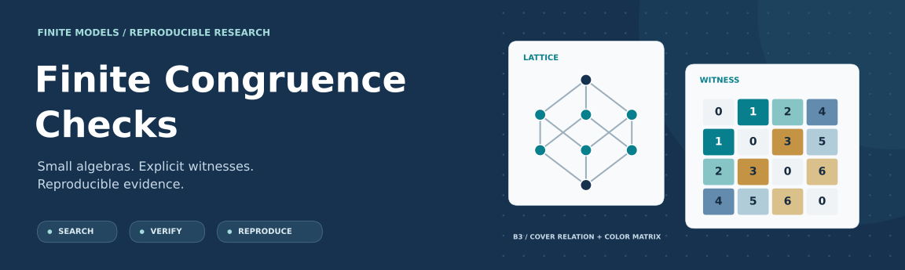
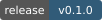
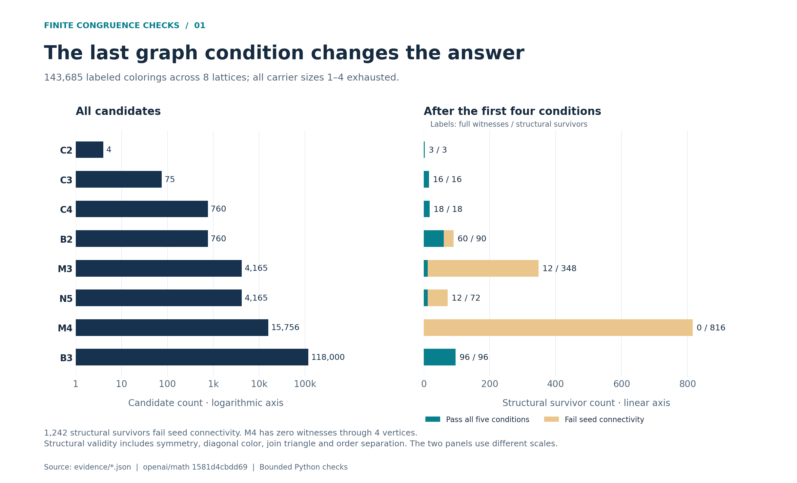
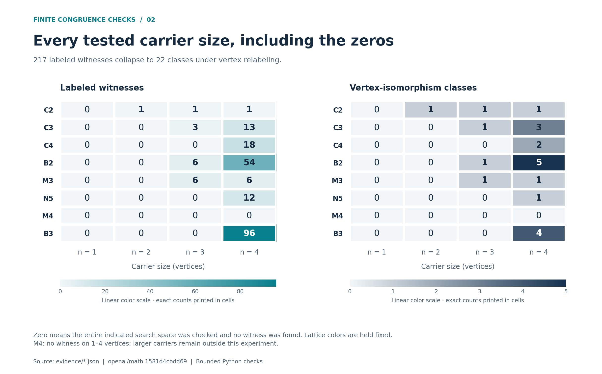
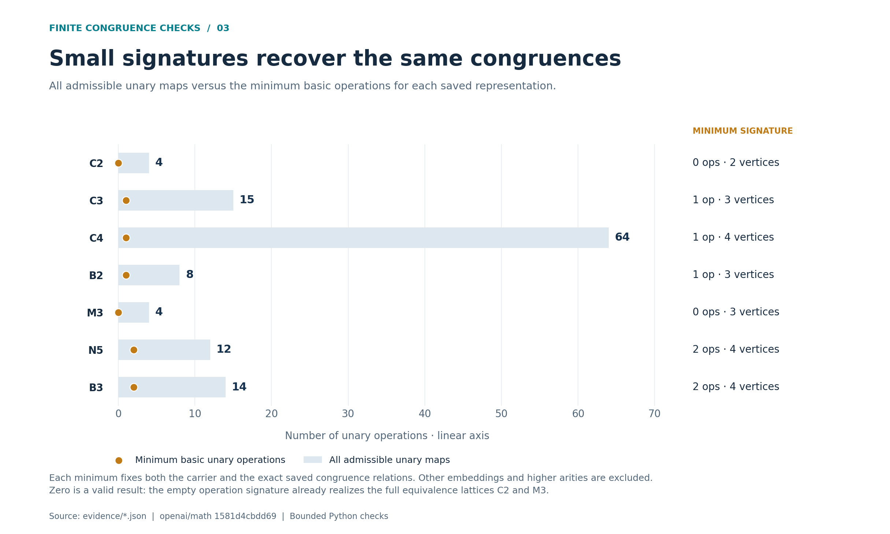
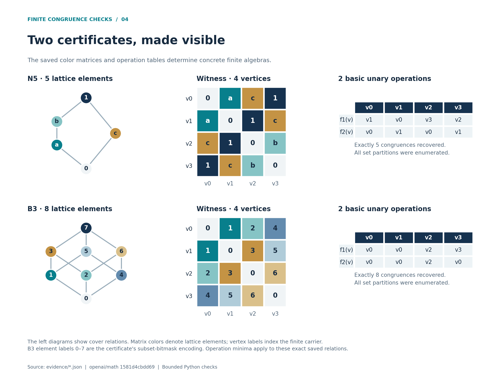

# Finite Congruence Checks



[](https://github.com/Maverick0351a/finite-congruence-checks/actions/workflows/verify.yml)
[](docs/LEAN_VERIFICATION.md)
[](https://github.com/Maverick0351a/finite-congruence-checks/releases/tag/v0.1.0)
[](LICENSE)
[](#quick-start)

A focused research toolkit for finite congruence lattices. Search colored graphs,
verify every quantified condition with an independent implementation, recover
the corresponding unary algebras, and find their smallest operation lists on a
fixed representation. The core experiment uses only Python's standard library.

The starting specification is the graph-witness criterion in
[OpenAI's math corpus, family 206](reference/README.md), pinned to an exact commit.
This is an independent companion project. Its results cover eight specified
lattices and carriers of size **one through four**.

**[Quick start](#quick-start)** · **[Evidence gallery](docs/index.html)** ·
**[Exact claims](docs/CLAIMS.md)** · **[Lean status](docs/LEAN_VERIFICATION.md)** ·
**[Changelog](CHANGELOG.md)** · **[Support](SUPPORT.md)**

| Candidate colorings | Full witnesses | Vertex classes | Saved examples |
|:--|:--|:--|:--|
| **143,685** | **217** | **22** | **7** minimum-carrier constructions |

The HTML gallery is self-contained and works offline. Download the repository
and open `docs/index.html` in a browser; GitHub displays HTML source in its file
viewer. Each figure is also available as PNG and editable SVG in `charts/`.

## Quick start

Python 3.10 or later. Clone the repository, enter it, and check a saved example:

```sh
git clone https://github.com/Maverick0351a/finite-congruence-checks.git
cd finite-congruence-checks
python verify_witness.py evidence/N5-witness.json --output runs/N5-check.json
```

You can also download the [tagged release](https://github.com/Maverick0351a/finite-congruence-checks/releases/tag/v0.1.0), including the evidence and checksum.
The command checks all five witness conditions, including every nonempty set
of ordered seed pairs. A successful run returns exit status 0.

Run the complete experiment and compare its mathematical results:

```sh
python run_experiment.py --out runs/reproduction
python scripts/check_evidence.py --evidence runs/reproduction --compare evidence
```

Choose a new or empty output directory. The full run includes the unit tests,
complete search, seven certificate checks, independent exhaustive replay,
congruence recovery, and exact operation minimization. Runtime is usually on the
order of a minute on a desktop; it depends on hardware.

## What the experiment found



| Lattice | Lattice elements | Smallest carrier found | Full admissible unary pool | Minimum selected unary operations |
|:--|--:|--:|--:|--:|
| C2 · chain | 2 | 2 | 4 | 0 |
| C3 · chain | 3 | 3 | 15 | 1 |
| C4 · chain | 4 | 4 | 64 | 1 |
| B2 · Boolean square | 4 | 3 | 8 | 1 |
| M3 · three-atom diamond | 5 | 3 | 4 | 0 |
| N5 · pentagon | 5 | 4 | 12 | 2 |
| B3 · Boolean cube | 8 | 4 | 14 | 2 |
| M4 · four-atom diamond | 6 | None through 4 | — | — |

The seven positive carrier sizes attain the elementary lower bound from chain
height. Operation minima fix the saved carrier **and exact congruence relations**;
other embeddings and higher arities are outside that minimization. Empty
operation signatures are allowed: all equivalence relations on two or three
points already form C2 or M3. M4's result is negative only within the stated bound.

<details>
<summary><strong>View every lattice × carrier-size result</strong></summary>



</details>

<details>
<summary><strong>Compare full unary pools with minimum operation lists</strong></summary>



</details>

See the [verification method](METHOD.md) for definitions and the
[research context](RESEARCH_CONTEXT.md) for the relationship to prior work.

## Why multiple checks matter

The independent graph verifier reproduced **94,509,661 ordered seed subsets**
across every structural survivor. Its algorithms include loops and both edge
orientations directly; the search uses a documented reduction to unordered edges.
A third calculation enumerates all unary maps and set partitions to recover the
actual congruence lattices.

Of 1,459 structural survivors, **1,242 fail connectivity**. These are useful
regression cases for implementations that check only the first four conditions.

An additional independent audit compares the operation minimizer with a
breadth-first search through congruence families. It checks all **313**
representable exact families on carriers of sizes 1–4, plus 60 impossible-family
controls. [Review scope and evidence](docs/RELEASE_REVIEW.md).

Lean 4.34.1 compiled the concrete N5/B3 congruence certificates and the actual
pinned upstream graph-criterion proof. Both projects passed bundled kernel
replay for their target modules. This validates the selected formal proof and
adds concrete checks of its finite constructions; the
[Lean record](docs/LEAN_VERIFICATION.md) specifies the dependency trust boundary
and the remaining comparator and Python-to-Lean connection work.

These implementations and reviews were developed with AI assistance in the same
session. Independent algorithms strengthen the checks; external peer review and
mathematical novelty have not been established. See the precise distinction
between computational evidence, concrete Lean proofs, and upstream verification
in [the claim ledger](docs/CLAIMS.md).

## Explore an example



```sh
# Recover every congruence of the algebra defined by a certificate.
python verify_algebra.py evidence/B3-witness.json --out runs/B3-algebra.json

# Minimize the unary operation list for this exact representation.
python minimize_operations.py evidence/B3-witness.json --out runs/B3-operations.json

# Search one target, exhaustively through four vertices.
python search.py --lattice N5 --max-vertices 4 --out runs/N5-search

# Independently audit every small representable congruence family.
python scripts/audit_operation_minima.py --out runs/operation-audit.json
```

Witness-verifier exit codes are **0** for a pass, **1** for a well-formed candidate
that fails, and **2** for malformed input or an explicit resource limit. The
search's certificate registry identifies the witnesses from that invocation;
leftover files in a reused search directory are not part of a new result.

## Rebuild the figures

```sh
python -m pip install -r requirements-charts.txt
python scripts/build_charts.py
python scripts/build_charts.py --check
```

Only chart generation needs third-party dependencies. Figures and the offline
gallery are generated from checked JSON inputs; `charts/chart-data.json` records
the plotted values and source hashes. The `--check` command needs only the standard
library. [Evidence and file formats](docs/EVIDENCE.md).

## Repository map

| Path | Purpose |
|:--|:--|
| [search.py](search.py) | Exhaustive bounded search and vertex-isomorphism classes |
| [verify_witness.py](verify_witness.py) | Independent literal graph-predicate checker and replay |
| [verify_algebra.py](verify_algebra.py) | Direct recovery of all unary-algebra congruences |
| [minimize_operations.py](minimize_operations.py) | Exact operation reduction for fixed relations |
| [evidence/](evidence/) | Certificates, complete results, stage logs, and integrity hashes |
| [lean/](lean/) | Concrete formal checks and pinned upstream source context |
| [charts/](charts/), [docs/index.html](docs/index.html) | Downloadable research figures and offline gallery |
| [scripts/](scripts/) | Evidence integrity, independent minima audit, figure generation |
| [.github/workflows/](.github/workflows/) | Automated replication on Linux and Windows |

Read the [contribution guide](CONTRIBUTING.md), [research roadmap](docs/ROADMAP.md),
and [development record](WORK_LOG.md). To cite the software, use [CITATION.cff](CITATION.cff)
and identify both this project's version and the upstream corpus commit.

Apache-2.0. Upstream source notices are retained in [NOTICE](NOTICE) and `reference/`.
