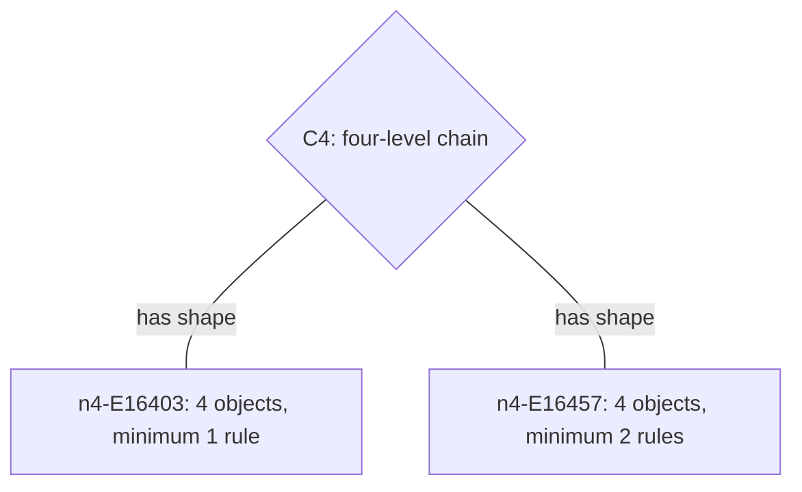

# The construction map

The atlas uses [Cytoscape.js](https://js.cytoscape.org/) to make relationships
between saved constructions and abstract shapes visible. Start with **C4** and
**4 objects**: two constructions connect to the same four-level chain, although
their exact grouping families require different numbers of unary rules.



Each rectangle represents a whole construction. Each diamond represents an
abstract shape. A line means **has this shape**. It does not represent a rule
acting on an object, an implication between claims, or a lattice cover. Those
other diagrams have their own explanations in the illustrated atlas. Moving a
node changes its screen position only; distance and placement mean nothing
mathematically.

## Explore and inspect

1. Choose a shape and object count. The initial C4 comparison fixes four objects.
2. Select a rectangle or use **Construction shown on the map**. Both select the
   same record and show its minimum, evidence status, and individual claim IDs.
3. Choose **Open rules & evidence** to open the exact entry in the catalog.
   Inspect its operations, every allowed grouping, and downloadable certificate.
4. Choose **All shapes** for an overview. Clicking a diamond narrows to that
   shape. Choose **All object counts** to compare carriers; the explicit scope
   message and node labels identify this change.

Drag nodes to rearrange them and drag the background to pan. The zoom buttons,
**Fit map**, and **Reset layout** are ordinary keyboard-accessible buttons.
Mouse-wheel zoom is disabled so scrolling the page remains predictable. The
selectors and inspector expose the graph's complete choices and relationships
without requiring interaction with canvas. If the library cannot load, those
controls still work. A filter with no matches says so and disables entry opening.

The palette uses midnight blue, tidal teal, and violet. Node shapes and written
labels carry the meanings as well as color. A gold outline marks the inspected
construction. The interface follows the device's light/dark preference, keeps
its graph layout unanimated, and respects reduced motion for page navigation.

## Record and evidence contract

`space/atlas-map.js` derives the view from `atlas-data.js` and `atlas-claims.js`.
Construction node IDs are the existing `nN-EM` entry IDs. Shape node IDs are the
existing `poset-v1:<canonical-order-hash>` keys from claim records. Display type
labels such as T06 are only used to select shapes within the loaded snapshot.
Every `has-shape:<entry-id>` link references its construction claim; each
construction also references its fixed-family minimum claim. The full registry
provides source JSON pointers, hashes, assumptions, and limits.

The browser checks identity/value consistency when building the map. CI checks
all 115 combinations of shape and carrier filters against the independently
generated review. Browser loading is not a cryptographic trust boundary: the
hash-verifying local query tool remains the structured evidence interface.
The map adds no new mathematical results or formal proof coverage.

The complete overview contains **39 construction nodes, 22 shape nodes, and 39
links**. A minimum fixes an exact relation family, its carrier, and unary
operations. Comparing two representations with the same shape does not make
either minimum a universal lower bound for that abstract shape.

## Reproduce the view checks

```sh
node scripts/check_atlas_ui.cjs
node scripts/check_atlas_map.cjs
node scripts/check_atlas_selection.cjs
python scripts/query_atlas.py build-claims --check
```

The map check loads the real vendored Cytoscape build in headless mode, checks
all graph components and entry-to-claim links, exercises seven rejection
controls, verifies library/license hashes, and checks the base stylesheet's
light/dark contrast tokens. The selection check exercises the actual Atlas
scripts together in a DOM/headless fixture, including exact claims and export
selection. Neither check establishes rendered behavior or contrast under every
stylesheet override. The yellow/black presentation still needs browser, narrow-
screen, keyboard and assistive-technology acceptance; no complete accessibility
certification is claimed.

Cytoscape.js 3.34.4 is vendored with its MIT license and integrity manifest in
[`space/vendor/`](../space/vendor/README.md). No CDN or package installation is
required to browse. Its [preset layout](https://js.cytoscape.org/#layouts/preset)
keeps the initial grouping deterministic. The query tool remains standard-library
Python; adding this browser view introduces no query-service dependency.
