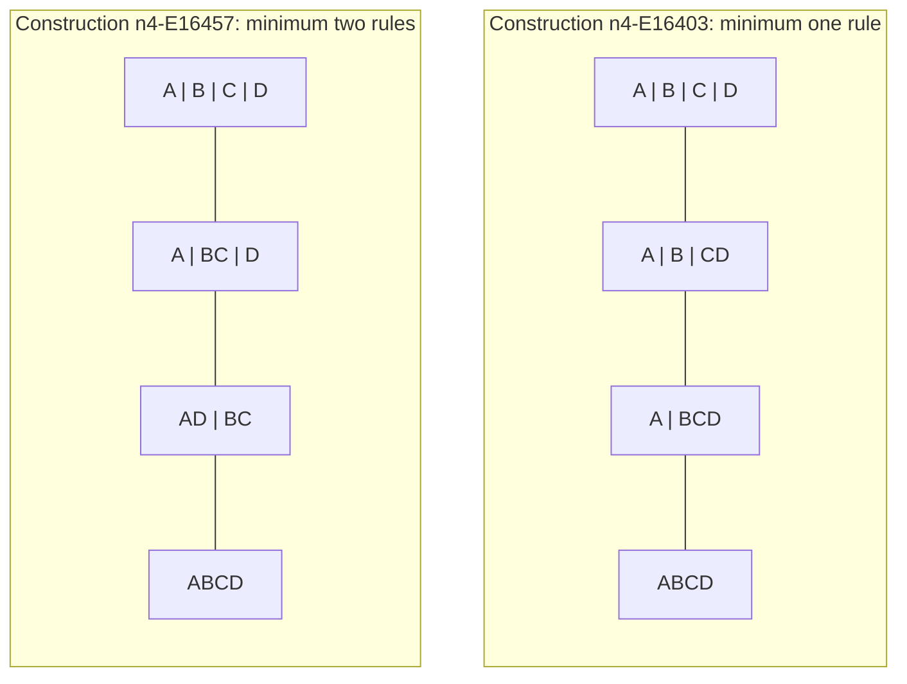

# A small agent retrieval evaluation

**Question:** “Which constructions share a lattice shape but need different numbers of rules?”

**Result:** The local query tool returned four such shape groups when the number of objects is held fixed: C3, B2, C4, and Shape T18, all on four objects. A separate agent inspected the actual CLI responses, followed the cited records, and checked the example below. The CLI tests also check every returned citation's file hash and JSON pointer.

This is a same-session AI retrieval and integration check, conducted on October 18, 2026 (America/Los_Angeles). The reviewing agent already had context from independently checking the atlas mathematics. This is not a blinded evaluation, an external replication, a benchmark of broader AI reasoning ability, or a measurement of human understanding.

## The answer in plain language

A construction is a small set of objects together with rules that move those objects. We collect every grouping that all the rules respect. Those groupings have a shape: some can be merged to reach others.

**Two constructions can produce the same shape while requiring different numbers of rules to produce their particular groupings.** Here are all four shape groups in the atlas exhibiting this difference on a fixed carrier. Each row gives one example on each side; the query returns all matching embeddings.

| Shape | Objects | Example requiring one rule | Example requiring two rules |
| --- | ---: | --- | --- |
| C3, a three-level chain | 4 | [n4-E16401](../evidence/atlas.json#L728), `/entries/8` | [n4-E16387](../evidence/atlas.json#L656), `/entries/7` |
| B2, a square | 4 | [n4-E16433](../evidence/atlas.json#L1134), `/entries/12` | [n4-E16451](../evidence/atlas.json#L1289), `/entries/14` |
| C4, a four-level chain | 4 | [n4-E16403](../evidence/atlas.json#L794), `/entries/9` | [n4-E16457](../evidence/atlas.json#L1384), `/entries/15` |
| Shape T18, a seven-element lattice | 4 | [n4-E19987](../evidence/atlas.json#L4313), `/entries/35` | [n4-E18967](../evidence/atlas.json#L3716), `/entries/32` |

“Requiring” refers to the minimum number of total unary rules for that exact family of groupings on its fixed objects. It is stronger than merely showing that the displayed rules work: the independent finite checker exhausted the smaller possibilities as well. These entries have computational evidence; the atlas does not assign them Lean proof status.

## The C4 example

Use A, B, C, and D for the four objects. Each box below is a whole grouping, and `|` separates groups. Moving upward merges groups.



Both diagrams have four boxes in a chain. The contents of the middle groupings differ. For the left construction, one rule suffices:

```text
A → B → C → D
            D → D
```

Its operation array is `[1, 2, 3, 3]`, with the objects numbered A=0 through D=3. The right construction uses `[0, 3, 3, 3]` and `[2, 0, 0, 1]`. The tool returns both the complete grouping lists and these rule arrays, so the explanation can be checked against the records.

The supporting claim IDs are `construction:n4-E16403`, `minimum:n4-E16403`, `construction:n4-E16457`, and `minimum:n4-E16457` in the [claim registry](../evidence/atlas-claims.json). The corresponding minimum claims begin at [line 1105](../evidence/atlas-claims.json#L1105) and [line 1759](../evidence/atlas-claims.json#L1759). Both constructions have the stable shape key:

```text
poset-v1:7d47898dc8a13484bdf81afc384143309b9e9b1aa1298f6495a0ae26e203cd19
```

That key binds the canonical order shape; C4 is its friendly name. Entry IDs bind concrete relation families. The comparison claim has ID `comparison:poset-v1:7d47898dc8a13484bdf81afc384143309b9e9b1aa1298f6495a0ae26e203cd19:n4`.

## Commands actually exercised

Run these from the repository root with Python 3.10 or newer:

```console
python scripts/query_atlas.py compare
python scripts/query_atlas.py compare --shape C4 --carrier 4
python scripts/query_atlas.py show n4-E16403
python scripts/query_atlas.py show n4-E16457
python scripts/query_atlas.py claims --entry n4-E16403
python scripts/query_atlas.py claims --entry n4-E16457
python scripts/query_atlas.py list
```

The first command returned C3, C4, B2, and Shape T18, with minimum rule counts `[1, 2]` in every group. The C4 comparison returned exactly `n4-E16403: 1` and `n4-E16457: 2`. The `show` commands returned the operations and partitions used in the diagrams above. The `claims` commands returned the two construction claims, their individual minimum claims, and their shared comparison claim.

The complete `list` response contains 39 embedding classes covering 22 abstract shapes. Grouping that response by its stable shape key, while allowing the object count to vary, produces six shapes with different minima: C2, C3, B2, M3, C4, and Shape T18. C2 and M3 enter only when different carrier sizes are compared. The default `compare` command deliberately keeps each comparison at a fixed object count.

## Evidence boundary and repeatable controls

The responses bind these files using SHA-256 with only CRLF normalized to LF:

| File | SHA-256 at evaluation |
| --- | --- |
| `evidence/atlas.json` | `9bd8976488b269a86468dfcdb9f9ebbf246cfe8e0ffe4960f86941369919c82a` |
| `evidence/atlas-review.json` | `f702ebcfd8addcb12aa8cf0434c074c8869a71ae738cd996727819d8f165cd26` |

For C4, the exact record pointers are `/entries/9` and `/entries/15` in both files. The query also cites the atlas's `/partitions`, `/operations`, and `/minimum_unary_operations` fields under each record. Thus a consumer can follow a claim to its construction and to the matching independent review record.

The independent review exhausts every candidate partition family on carriers of one through four objects. The query itself checks saved evidence integrity; it does not repeat that mathematical exhaustion on each call. The coverage boundary is finite unary algebras on these carriers, and empty signatures are allowed. These minima do not optimize over larger carriers, different embeddings, or higher-arity operations. No claim of mathematical novelty or outside peer review follows from this retrieval evaluation.

The automated controls are in [test_atlas_query.py](../scripts/test_atlas_query.py): combined filters, all 39 IDs and shape keys, equivalent shape selectors, exact construction retrieval, fixed-carrier comparisons, complete comparison-group coverage, claim scopes and citations, invalid IDs, stale atlas evidence, and reproducible claim generation. Run:

```console
python -m unittest discover -s scripts -p "test_atlas_query.py" -v
python scripts/query_atlas.py build-claims --check
python scripts/check_atlas.py --check-receipt evidence/atlas-review.json
```

See [the query guide](ATLAS_QUERY.md) for the response schema and additional examples.
