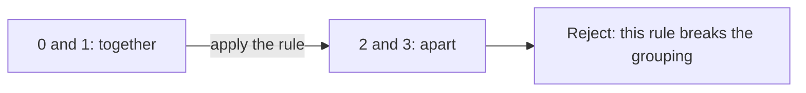
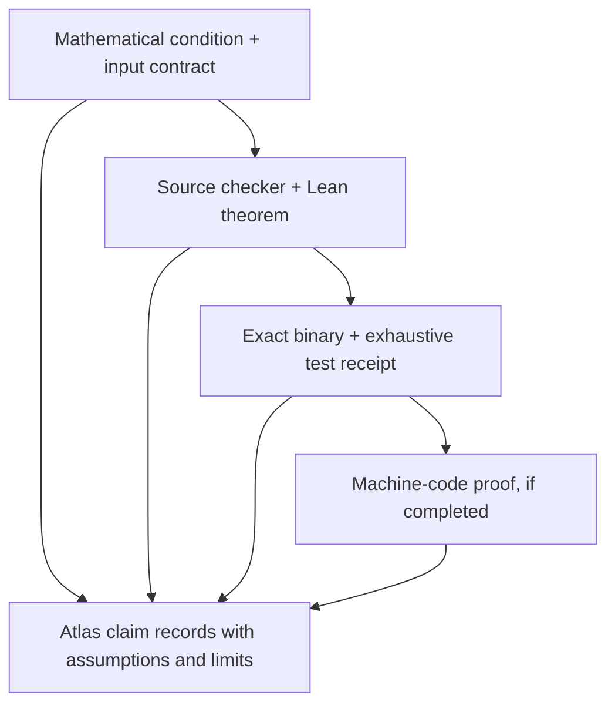

# From mathematical certificates to checked executables

Status: proposed next milestone. The project has computational atlas checks and
separate concrete Lean proofs for the exact saved N5/B3 graphs. A shared shape
name does not transfer those proofs to an atlas entry. The project does not yet
have a general executable certificate-checker theorem or a machine-code proof.

## The mathematical question

For a unary operation `f` and a grouping relation `R`, preservation means

```text
For every x and y:  R(x, y) implies R(f(x), f(y)).
```

In ordinary language: objects grouped together must still be grouped together
after applying the rule. For example, if 0 and 1 are grouped together but the
rule sends them to 2 and 3 in different groups, that grouping fails.



If the input is an arbitrary relation, also check that it is an equivalence
relation: reflexive, symmetric, and transitive. For several operations, check
preservation for every operation. Acceptance of one grouping establishes that
it is a congruence. Establishing the **entire** congruence family additionally
requires ruling out every other equivalence relation. Neither check alone
establishes minimum rule count, a minimum carrier, or completeness of a search.

The current `Preserves`, `IsEquivalence`, and `IsCongruence` definitions in
[`lean/FiniteCongruenceChecks.lean`](../lean/FiniteCongruenceChecks.lean) already
express these conditions on four points. Its `relation_complete` theorem and
concrete N5/B3 classifications provide a useful starting point. The next theorem
must relate a reusable Boolean checking function to the stated proposition for
all inputs in its declared domain.

## A deliberately small first experiment

Use four objects and one unary operation, with no networking or file handling
inside the checking core. A proposed fixed-width input is a 16-bit word:

| Bits | Meaning |
| --- | --- |
| 0–7 | Four two-bit operation outputs, each in 0–3 |
| 8–13 | Six unordered relation pairs, using the existing `Shape` pair order |
| 14–15 | Reserved; nonzero values must be rejected |

The relation decoder supplies true diagonal entries and symmetric pairs. The
checker still needs to establish transitivity. This encoding makes all 65,536
raw words enumerable, including malformed reserved bits. These counts are
experiment design bounds, not results from a completed executable test.

1. **Prove the source checker.** Specify decoding and rejection behavior in Lean;
   prove `check word = true` if and only if the word decodes to an equivalence
   relation preserved by its operation. Record the theorem, exact source hash,
   pinned toolchain, kernel replay, and axiom report. Use kernel-checked proofs.
2. **Test an exact executable.** Compile the same checker and compare all raw
   words with an independently implemented reference. Record binary SHA-256,
   target architecture, compiler and flags, runtime/link dependencies, harness
   version, input count, and mismatches. Include deliberate checker mutations
   that the comparison must detect. Test decoding separately from the core.
3. **Attempt one machine-code proof.** Select the exact compiled function and
   connect its instruction semantics to the same specification. State the ISA,
   calling convention, entry/exit conditions, memory assumptions, and treatment
   of runtime calls. If a smaller C implementation is introduced, prove its
   relationship to the reference separately. Preserve unsupported instructions
   or incomplete obligations as an incomplete result.
4. **Generalize the certificate contract.** Extend from one grouping to exact
   relation families, retaining separate soundness, family-completeness, and
   minimality claims. Allow AI search to propose certificates; require the
   relevant checker before accepting the corresponding claim into the atlas.

Exhaustive executable agreement supports only that binary, enumerated inputs,
and observed environment. It does not establish correctness over arbitrary
machine states, validate the compiler generally, or replace a machine-code
proof. A binary hash identifies bytes; it is not a correctness argument.

## Evidence an agent should retrieve



Each arrow requires an explicit recorded connection. Store distinct claims for
source correctness, bounded executable agreement, and binary refinement. Link
them to the specification version, source and binary hashes, theorem names,
test receipts, counterexamples, and remaining assumptions. Use separate claim
kinds and a versioned schema extension before adding software-verification
records to the mathematical registry. Missing evidence must remain visibly
missing; an agent must not infer a later achievement from an earlier one.

REA can inspect branches, data handling, and disassembly and propose candidate
invariants or counterexamples. Its explanations remain hypotheses until tests
or a formal checker support the relevant claim. A decompiler's output is also
a representation whose relationship to the binary needs justification.

## Relevant foundations

Lean's [trust-boundary FAQ](https://lean-lang.org/faq/#what-is-the-trusted-code-base-of-lean)
explicitly includes the compiler, runtime, backend, and linked external code
when relying on verified Lean programs executed as native binaries. This is a
different assurance boundary from checking a mathematical proof term.

[seL4's proof overview](https://sel4.systems/Verification/proofs.html) describes
binary correctness for supported configurations, connecting machine code to
the C behavior used by its functional correctness proof.
[Alive2](https://github.com/AliveToolkit/alive2) validates LLVM transformations;
its scope and unsupported transformations must be respected. Neither project
automatically verifies our compiled checker. The opportunity here is a focused,
reproducible chain of evidence for finite congruence checks.
