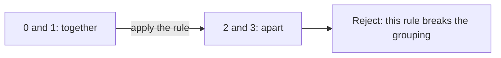
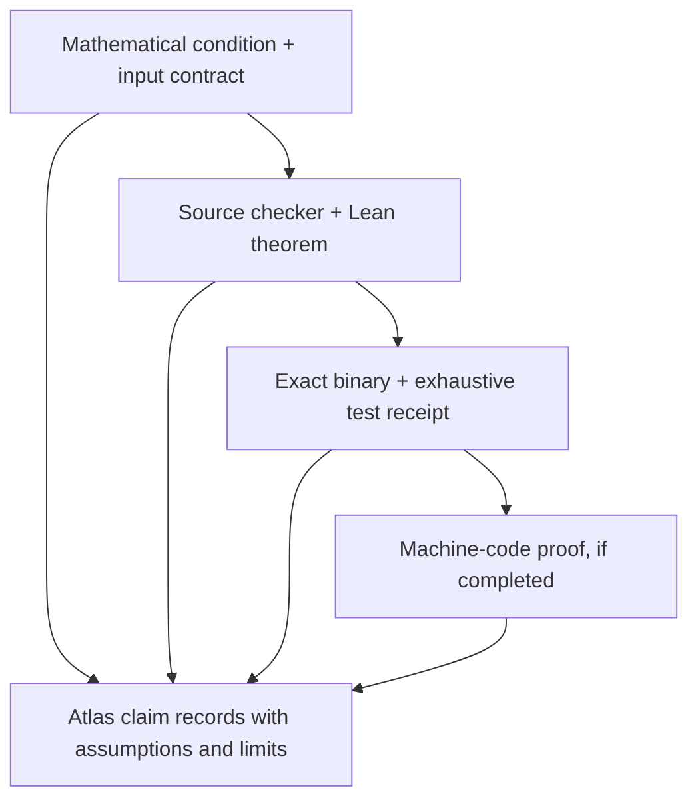

# From mathematical certificates to checked executables

Status: proposed next milestone. The project has computational atlas checks and
separate concrete Lean proofs for the exact saved N5/B3 graphs. A shared shape
name does not transfer those proofs to an atlas entry. The project does not yet
have a general executable certificate-checker theorem or a machine-code proof.

## The mathematical question

For a unary operation `f` and a grouping relation `R`, preservation means

```text
For every x and y:  R(x, y) implies R(f(x), f(y)).
```

In ordinary language: objects grouped together must still be grouped together
after applying the rule. For example, if 0 and 1 are grouped together but the
rule sends them to 2 and 3 in different groups, that grouping fails.



If the input is an arbitrary relation, also check that it is an equivalence
relation: reflexive, symmetric, and transitive. For several operations, check
preservation for every operation. Acceptance of one grouping establishes that
it is a congruence. Establishing the **entire** congruence family additionally
requires ruling out every other equivalence relation. Neither check alone
establishes minimum rule count, a minimum carrier, or completeness of a search.

The current `Preserves`, `IsEquivalence`, and `IsCongruence` definitions in
[`lean/FiniteCongruenceChecks.lean`](../lean/FiniteCongruenceChecks.lean) already
express these conditions on four points. Its `relation_complete` theorem and
concrete N5/B3 classifications provide a useful starting point. The next theorem
must relate a reusable Boolean checking function to the stated proposition for
all inputs in its declared domain.

## A deliberately small first experiment

Use four objects and one unary operation, with no networking or file handling
inside the checking core. The selected input contract is `unary-grouping-v1`,
also recorded in [machine-readable form](../specs/unary-grouping-v1.json).
It uses a 16-bit word, with bit 0 the least significant bit:

| Bits | Meaning |
| --- | --- |
| `2i` and `2i+1`, for i = 0,1,2,3 | Operation output f(i), each in 0–3 |
| `8+2i` and `9+2i`, for i = 0,1,2,3 | Group label g(i), each in 0–3 |

Thus `f(i) = (w >> (2i)) & 3` and `g(i) = (w >> (8+2i)) & 3`.
Objects x and y are in the same group exactly when `g(x) = g(y)`. Equality of
labels automatically defines an equivalence relation; this particular encoding
does not need a separate transitivity test. Every integer from 0 through 65,535
is a valid payload. There are 256 operation tables and 256 group-label arrays,
so there are exactly 65,536 inputs. Several label arrays encode the same one of
the 15 partitions. All labelings remain in the test domain, and distinct encoded
inputs keep distinct IDs. These are design counts, not a completed binary test.

This contract supersedes the initial six-relation-bit/two-reserved-bit proposal.
That different format also had 65,536 raw words, but different decoding and
invalid-input semantics. No implementation or binary was built for that draft.

### Exact correctness obligations

For every word `w` in `Fin 65536`, the required source theorem is:

```text
check(w) = true  ↔
  for every x,y in Fin 4,
    g_w(x) = g_w(y) implies g_w(f_w(x)) = g_w(f_w(y)).
```

Also prove that the decoder realizes the bit definitions above and that
encoding its decoded fields returns the original word. The integer boundary
must return `invalid_input` exactly when `z < 0` or `z >= 65536`; it must not
silently truncate, wrap, or clamp. A later serialized interface must reject
malformed values (including booleans and non-integer JSON values) separately
from a valid input whose grouping fails. The pure core operates on a 16-bit word;
parsing remains outside it. If bytes are used, the harness must accept exactly
two bytes, least significant byte first, with that adapter tested separately.

For example, `0x50a0` decodes to `f=[0,0,2,2]` and `g=[0,0,1,1]`, which
preserves the grouping. Changing only f(1) to 2 gives `0x50a8`: objects 0 and 1
start together, but f(0)=0 and f(1)=2 have different labels. These are manually
specified examples with expected results, not executable-checker evidence.

1. **Prove the source checker.** Specify decoding and rejection behavior in Lean;
   prove the equivalence and decoding obligations above. Record the theorem, exact source hash,
   pinned toolchain, kernel replay, and axiom report. Use kernel-checked proofs.
2. **Test an exact executable.** Compile the same checker and compare all raw
   words with an independently implemented reference. Record binary SHA-256,
   target architecture, compiler and flags, runtime/link dependencies, harness
   version, input count, and mismatches. Include deliberate checker mutations
   that the comparison must detect. Test decoding separately from the core.
3. **Attempt one machine-code proof.** Select the exact compiled function and
   connect its instruction semantics to the same specification. State the ISA,
   calling convention, entry/exit conditions, memory assumptions, and treatment
   of runtime calls. If a smaller C implementation is introduced, prove its
   relationship to the reference separately. Preserve unsupported instructions
   or incomplete obligations as an incomplete result.
4. **Generalize the certificate contract.** Extend from one grouping to exact
   relation families, retaining separate soundness, family-completeness, and
   minimality claims. Allow AI search to propose certificates; require the
   relevant checker before accepting the corresponding claim into the atlas.

Exhaustive executable agreement supports only that binary, enumerated inputs,
and observed environment. It does not establish correctness over arbitrary
machine states, validate the compiler generally, or replace a machine-code
proof. A binary hash identifies bytes; it is not a correctness argument.

## Evidence an agent should retrieve



Each arrow requires an explicit recorded connection. Store distinct claims for
source correctness, bounded executable agreement, and binary refinement. Link
them to the specification version, source and binary hashes, theorem names,
test receipts, counterexamples, and remaining assumptions. Use separate claim
kinds and a versioned schema extension before adding software-verification
records to the mathematical registry. Missing evidence must remain visibly
missing; an agent must not infer a later achievement from an earlier one.

For each checked input, a future result record must include:

| Field | Required meaning |
| --- | --- |
| `status`, `input_id`, `input` | Distinguish a specification example from an evidenced result; `ug4-v1:` followed by four lowercase hex digits identifies the exact word, decoded operation, and group labels |
| `claim_id`, `claim_kind`, `specification` | Exact preservation claim for that input and the version/hash of this contract |
| `checker` | Version, source revision/hash, and relevant theorem declaration |
| `outcome` | `preserves: true` or `preserves: false` for a valid input; false includes an explicit violating pair |
| `evidence` | Kind, immutable artifact path/hash, and pointer to this case in its run receipt |
| `assumptions`, `limits` | The precise domain and remaining source/runtime/machine assumptions |

A false preservation outcome is a legitimate mathematical result. Record
checker/reference agreement separately: agreement can hold when both return
false. An invalid input is neither a preserved nor a broken grouping.

A binary run receipt must additionally identify the exact binary hash,
architecture, compiler/settings, linked runtime, independent reference version
and source hash, harness source hash and command, all covered words, actual
tested and distinct-word counts, and every disagreement. The reference
must independently decode the word and evaluate the condition without importing
the checker's implementation. Keep disagreements reproducible with the exact
word and both outputs. Claim full coverage only when the distinct covered words
are exactly 0 through 65,535. Record malformed-input adapter tests separately;
they are outside that finite word domain.
Proposed examples carry `status: specification_example`, null checker and outcome,
and empty evidence. They cannot be presented as checked results. The examples in
the machine-readable contract demonstrate that distinction and intentionally
lack the evidence and artifact hashes required of future `evidenced_result`
records. For such records, require the specification ID, version, and SHA-256
of its exact artifact bytes, encoded as 64 lowercase hexadecimal digits. Recompute
that hash against the selected contract before admitting the record; a matching
name or version alone is insufficient. Implement and test
the result schema and cross-field consistency rules before accepting real results.

REA can inspect branches, data handling, and disassembly and propose candidate
invariants or counterexamples. Its explanations remain hypotheses until tests
or a formal checker support the relevant claim. A decompiler's output is also
a representation whose relationship to the binary needs justification.

## Relevant foundations

Lean's [trust-boundary FAQ](https://lean-lang.org/faq/)
explicitly includes the compiler, runtime, backend, and linked external code
when relying on verified Lean programs executed as native binaries. This is a
different assurance boundary from checking a mathematical proof term.

[seL4's proof overview](https://sel4.systems/Verification/proofs.html) describes
binary correctness for supported configurations, connecting machine code to
the C behavior used by its functional correctness proof.
[Alive2](https://github.com/AliveToolkit/alive2) validates LLVM transformations;
its scope and unsupported transformations must be respected. Neither project
automatically verifies our compiled checker. The opportunity here is a focused,
reproducible chain of evidence for finite congruence checks.
