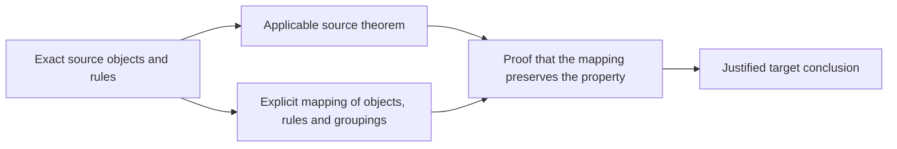

# When does the evidence apply?

Status: **eight public development tasks prepared; zero answering sessions
scheduled or run**. The original PR #10 pilot, its two selected tasks, and four
reserved task families are unchanged. This preparation does not resume it.

Suppose we rename four objects. A drawing can still look the same. To reuse a
proof, we must also map the rules and the groupings consistently. These tasks
ask whether a cited result actually justifies the proposed conclusion.



The boxes represent mathematical objects or evidence; arrows show the inputs
needed for the target conclusion. A similar-looking diagram alone supplies no
mapping or preservation proof. An unsuccessful exact record match also does not
show that the proposed mathematical statement is false.

## Prepared cases

Exact wording is in [tasks.json](../benchmarks/evidence-applicability-v1/tasks.json).
Each task has two named questions. Both conditions receive the same assigned
questions, instructions, answer format and general eight-dimension rubric.
The table below is controller documentation and is not served to answerers.

| Task | Objects examined | Distinction tested |
| --- | --- | --- |
| EA01 | Saved four-object N5 | Complete classification versus rule minimality |
| EA02 | N5 rotation with rule reindexing | A legitimately proved transfer |
| EA03 | Same target with a proposed rule map | Rule correspondence versus target classification |
| EA04 | Two C4 relation families | Same abstract shape versus fixed-family minima |
| EA05 | Exact tiny-stay pair on `[]` | First halt, heads, complete tapes, implementation scope |
| EA06 | Tiny-stay with an unused table entry changed | Exact proof coverage versus a new execution deduction |
| EA07 | Tiny-stay at steps zero and one | A lemma's required halting hypothesis |
| EA08 | Recorded native comparison | Bounded agreement versus universal implementation equivalence |

These are deliberately selected, overlapping examples from public project
history. They are not held-out tasks, independent mathematical experiments, or
a contamination-free benchmark. Some requested facts are explicit in the
sources, so ceiling effects remain possible. Their purpose is to find design,
retrieval, and scoring problems before selecting any new evaluation.

The original reserved M3, saved-N5/atlas-N5 comparison, BB3/BB4 exporter, and
nonblank-input cases are not included or changed. This suite uses the saved N5
and its rotation; it does not compare the saved construction with atlas N5.

## Same facts, two presentations

Sources are frozen at `5a6e46de73ed045e72149f4f912e2bbee0463086`, the merged
PR #11/#12 tree. The [manifest](../benchmarks/evidence-applicability-v1/freeze.json)
pins exact Git bytes, generated packet hashes, protocol and task hashes, and
the preparation script. The existing evidence schema is unchanged.

The documentation condition is Markdown reference documentation generated from
existing records: headings, prose fields and ordered values. The atlas condition
presents those same existing records as
JSON. Neither gets an added task answer, comparison verdict or analogy. The
18 raw source/receipt/input units have identical text in both conditions;
eight record units use the two renderings. Selection is documented by exact
JSON pointers or original line numbers. The controller fact map records every
value and container, including assumptions, limits, nulls and empty lists.

Both conditions use the unchanged [search/read broker](../benchmarks/evidence-applicability-v1/broker.py)
from PR #10 commit `a16a9da5cd84c7c4b87326badeff7750a53f56f2`.
The same inventory produces the same search ranking and neutral reference IDs.
Only `read` rendering differs. Full Lean files and receipts, selected records,
and six original rows from each input/output file are available with all their
pages through the same interface. Original source URLs are provenance, not permission to browse
outside the supplied collection. A cited file may mention related artifacts not
included in this small collection; absence here does not imply global absence.

Automated reconstruction and corruption checks establish data parity and drift
detection. This is a rendering feasibility comparison; it cannot establish a
benefit over ordinary prose documentation in general. Matching the underlying
facts also does not prove identical cognitive difficulty. A separate preparation
reviewer inspects for unequal hints.

## Scoring and answer-key isolation

The [rubric](../benchmarks/evidence-applicability-v1/rubric.json) is copied from the
original pilot: objects/inputs, property, assumptions, scope/quantifiers,
conclusion, evidence status, citations, and evidence sufficiency, each 0–2.
Its larger handoff provisions remain deferred. The common answer format makes
exact propositions, values and citations inspectable. Valid JSON earns no
semantic credit. Missing fields stay missing.

The task-specific key is an ignored local controller artifact, with a public
[hash commitment](../benchmarks/evidence-applicability-v1/key-commitment.json).
It contains accepted conclusions, explicit unsupported extensions, source
bindings, acceptable deductions, and scoring examples. Neither packet includes
the key, tasks for other sessions, rubric annotations, or the controller fact
map. Keep the key separately when transferring this preparation to another host;
the public repository cannot regenerate its private contents.

The key was authored alongside these tasks. Its integrity and question/reference
coverage have offline checks; the preparation reviewer does not receive it.
Independent semantic review and scorer calibration remain execution gates.

Offline broker calls deny key paths and other-condition paths. **This is not
live host isolation.** An answering process with general filesystem, network or
delegation access could bypass the broker. That process must not be launched
until a dummy preflight demonstrates the required restrictions and usage capture.

For later review, give a fresh reviewer one unedited response, its task and key,
and canonical sources. Hide condition/model/order/cost metadata, randomize
response IDs and review order, and preserve original citations with a separate
normalization map. Use the [reviewer prompt](../benchmarks/evidence-applicability-v1/reviewer-prompt.txt).
Lock scores before asking for a condition guess; style may reveal the condition.
Preparation review is not blind outcome review. A runtime scorer and randomization
record must be finalized and pinned before approval for execution.

Report supported-transfer success and unsupported-claim acceptance separately.
Report every dimension's improvements, ties and regressions. Distinguish
both-correct from both-wrong ties. Preserve all refusals, technical failures and
original errors; do not edit answers before scoring or count retries as new tasks.

## Usage and remaining gates

No native preflight or benchmark model session ran during this preparation.
Actual benchmark tokens are **unavailable/null**, not a measured zero. Ordinary
authoring and AI preparation review are outside the benchmark usage figures.

The candidate ceiling is 16 search/read calls, 64,000 returned UTF-8 bytes,
300 seconds and a 30,000-token soft interruption threshold per answer. The last
threshold is not a hard billing cap. Reviewing has its own proposed limits in
[protocol.json](../benchmarks/evidence-applicability-v1/protocol.json).
Reference bytes do not measure cumulative model tokens; repeated context and
reasoning can dominate. The controller checks sample retrieval paths but does
not provide those paths to answerers.

No subset has been scheduled. If all eight tasks were later used under both
conditions, that would be 16 answers plus 16 blind reviews. Reusing the old,
uncalibrated per-session assumptions gives **264,000–760,000 tokens** for that
larger design. It is neither measured usage nor a bill. The original four-answer
plus four-review estimate remains **66,000–190,000**. Choose a small subset,
calibrate on a dummy, and show a revised estimate before any execution approval.

Required gates remain: matched-fact review, private key/scorer integrity, fresh
contexts, search/read-only enforcement, complete actual usage and error logs,
watchdog interruption, equal settings, per-task budgets and explicit user approval.
The previous transport initialization failures are unresolved by packet generation.
No paid API, new credentials or security-setting changes are part of this work.

## Reproduce preparation only

Python 3.10+ and Git are sufficient. A clone must contain the pinned mathematical
source commit; in a shallow checkout fetch that commit first. The broker is
vendored and checked against its previously verified original SHA-256, so PR #10
branch history is not needed to reproduce preparation.

```sh
python scripts/applicability_packets.py check
python scripts/applicability_packets.py build --out runs/applicability-packets-new
python -m unittest discover -s scripts -p test_applicability_packets.py -v
```

`build` requires a new output directory and never overwrites an existing packet.
It creates separate `documentation/` and `atlas/` folders, condition-independent
single-task prompts in `prompts/`, and a controller-only fact map above them.
Deliver only the assigned prompt and one condition through the broker; never
mount the containing preparation directory. This layout is not a sandbox.
`check-key --key PATH` additionally checks a private key against its commitment
and question/reference coverage; it does not validate semantic judgments.
`check-paths --key PATH` reproduces the controller-selected retrieval counts in
the [preparation report](../benchmarks/evidence-applicability-v1/preparation-report.json).
It uses the key's suggested references plus the same two generic searches for
each task. These privileged paths establish only that the material fits; they
must not be supplied to answerers or reported as their observed effort.

No mathematical search, proof rebuild, simulation, native probe or model call is
made by these commands. Existing Lean proofs and receipts are source material.
Substantial AI assistance was used to author and review this preparation.
