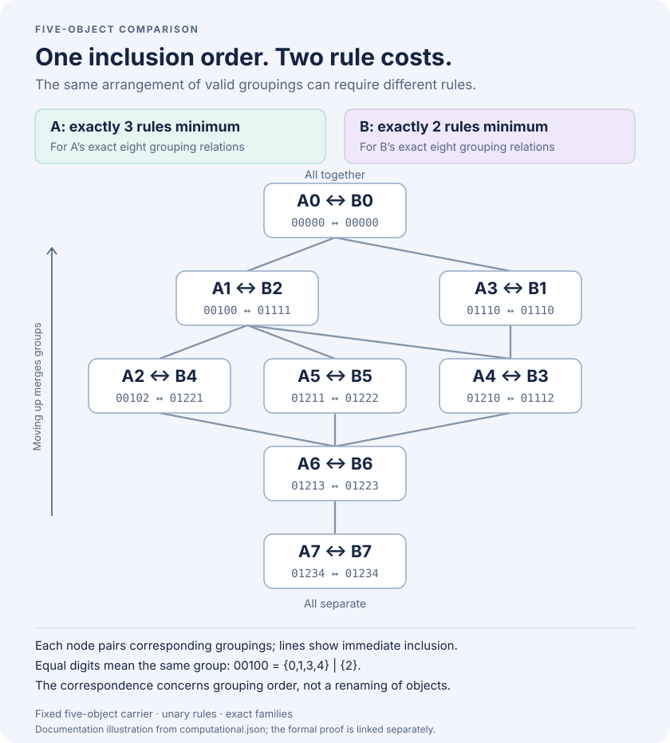

# Why the same lattice shape can cost different numbers of rules

## The result

This milestone formalizes a saved computational example from the five-object
exploration. It is new formal coverage of an existing finding. Mathematical
novelty has not been established.

We use the objects `0, 1, 2, 3, 4`. A grouping is valid for a rule when objects
that start together still belong together after applying that rule. The goal
is to choose rules that allow exactly a specified collection of groupings.

| Construction | Rule output lists, in object order 0–4 | Proved minimum |
| --- | --- | --- |
| A | `(0,0,4,0,0)`, `(0,3,1,1,4)`, `(1,1,3,3,3)` | Three unary rules |
| B | `(4,1,3,2,4)`, `(1,2,3,3,3)` | Two unary rules |

Both constructions have exactly eight valid groupings. Their
inclusion diagrams have the same shape, although the actual grouping families
on these five named objects differ. The Lean proof establishes these exact
classifications, an explicit order correspondence, and the two exact-family
minimum rule counts.



Read a grouping code from left to right for objects `0` through `4`: equal
digits mean the objects are together. For example, `00102` means the blocks
`{0,1,3}`, `{2}`, and `{4}`. Lower nodes in the diagram separate more objects;
higher nodes merge blocks. Each node records the corresponding A and B
groupings; some coincide.

| A grouping | Corresponding B grouping |
| --- | --- |
| `00000` | `00000` |
| `00100` | `01111` |
| `00102` | `01221` |
| `01110` | `01110` |
| `01210` | `01112` |
| `01211` | `01222` |
| `01213` | `01223` |
| `01234` | `01234` |

The correspondence preserves every inclusion comparison. It matches the eight
groupings; it does not claim that renaming the five objects carries A to B.

## The lower-bound idea

Finding three rules that work only proves that three are enough. To prove they
are necessary, we must exclude every choice of two rules, including rules we
did not use in the construction.

For A, four unwanted groupings give a compact obstruction:

| Code | Blocks |
| --- | --- |
| `00001` | `{0,1,2,3}` and `{4}` |
| `00123` | `{0,1}`, `{2}`, `{3}`, `{4}` |
| `01230` | `{0,4}`, `{1}`, `{2}`, `{3}` |
| `01231` | `{0}`, `{1,4}`, `{2}`, `{3}` |

A candidate rule must preserve all eight desired groupings. Among such rules,
the possible preservation patterns on the four unwanted groupings are:

| Pattern | First | Second | Third | Fourth |
| --- | --- | --- | --- | --- |
| 1 | No | Yes | Yes | Yes |
| 2 | Yes | No | No | Yes |
| 3 | Yes | No | Yes | No |
| 4 | Yes | Yes | No | No |
| 5 | Yes | Yes | Yes | Yes |

Every two rows share a **Yes** in at least one column. Consequently, every pair
of candidate rules allows at least one unwanted grouping. No pair realizes A's
exact family. The proof must establish that this table covers all rules, rather
than assuming the computational search found them all.

For a concrete rejection, A's first rule breaks `00001`: objects `0` and `2`
start in the same block, but their outputs `0` and `4` lie in different blocks.
Every admissible rule that breaks this first obstruction leaves the other three
intact. One more admissible rule can break at most two of those remaining three.
That is why a pair cannot finish the job. The supplied three rules together
eliminate every extra grouping.

For B, use the unwanted groupings `00001` and `00110`. Every rule that preserves
B's eight desired groupings also preserves at least one of these two extras.
One rule cannot realize B's exact family; the displayed pair does.

## What is checked

The [standalone Lean project](../lean/five_object/FiveObjectMinimum.lean) uses
the standard library and a pinned Lean version. It treats a grouping as an
arbitrary equivalence relation, with a proved bridge to the finite Boolean
representation. Its lower bounds range over every total map on the carrier.
A proved identity-padding argument includes zero-rule systems, shorter lists,
and repeated rules. The exact operation tables, grouping lists, minimum counts,
and correspondence are bound by [typed Lean obligations](../lean/five_object/FiveObjectBinding.lean).

The [independent Python audit](../scripts/check_five_object.py) enumerates all
52 partitions and all 3,125 unary maps. A has 67 admissible maps; all 2,278
unordered pairs with repetition fail to realize its exact family. B has 63
admissible maps, none realizing its family alone. Its two displayed maps do.
The audit also checks all 64 inclusion comparisons under the correspondence.
These are finite computations, separate from the Lean proof.

The [claim record](../evidence/five-object-v1/claim.json),
[computational receipt](../evidence/five-object-v1/computational.json), and
[Lean proof receipt](../evidence/five-object-v1/proof/summary.json) have different
roles. A hash identifies bytes; a fresh Lean
run checks the formal statement. Exact record matching alone cannot decide
whether an arbitrary changed construction satisfies a new theorem.

The saved Linux run completed all 12 stages: build, version check, 29 declaration
axiom reports, replay of all six project modules, and eight expected Lean
rejections. Only `propext`, `Classical.choice`, and `Quot.sound` occur in the
audited dependencies; no `sorryAx` or additional axiom is permitted. Its total
stage time was 178.44 seconds on the development machine with a clean build
directory. This is a reproduction timing, not a model-usage estimate.

## Reproduce from a fresh checkout

Prerequisites: Git, Python 3.10 or later, and `lake` with the pinned
`leanprover/lean4:v4.34.1` toolchain available. This sibling project has no
external Lean packages or Python package dependencies.

```sh
git clone https://github.com/Maverick0351a/finite-congruence-checks.git
cd finite-congruence-checks
python scripts/five_object_proof.py run --out runs/five-object-fresh
```

Use a new output directory on each run. The verification command recomputes
the independent finite audit, checks generated-record freshness, builds the
proof and its exact binding, audits the allowed axioms, and runs `leanchecker`
on the project modules. It then requires Lean to reject eight deliberate
changes: an operation, a grouping, the correspondence, the grouping count,
the order conclusion, the minimum count, an unrelated classification theorem,
and an unrelated lower-bound theorem.

The existing required **Concrete Lean certificates** CI job runs the same
command in a fresh checkout. The Python matrix separately replays the saved
receipt and runs 26 focused enumeration, binding, and integrity tests.

To inspect the recorded evidence without invoking Lean:

```sh
python scripts/five_object_proof.py replay
python scripts/query_context.py explain context:family-206:five-object:operation-minima:v1 --out five-object-claim.json
python scripts/query_context.py check five-object-claim.json
python scripts/build_five_object_chart.py --check
```

`explain` checks the saved formal receipt and independently recomputes the
finite audit. `check` compares a proposed export to that registered record.
Changing a table or theorem reference yields `unsupported`; that means the
registered evidence does not support the altered claim. It does not mean
every altered claim is false.

## Scope

These are unary operations on exactly five objects. An order isomorphism between
the eight-element grouping lattices does not itself provide a relabeling of the
five objects. The result does not assert a minimum over all embeddings of the
shape, larger carriers, or operations with more than one input. It does not
classify all five-object congruence families or measure agent performance.

The historical exploration and its receipts are preserved separately. Fresh
Lean checking, independent finite enumeration, and exact record binding are
recorded as separate forms of evidence. The [independent implementation
review](FIVE_OBJECT_REVIEW.md) records findings and their resolution.

The larger research context is [OpenAI math family 206](https://github.com/openai/math/blob/1581d4cbdd69a0faf34b2089614fe2a814316a6a/lean/docs/206.md).
This example concerns finite congruence representation. It does not extend the
upstream formalization to the paper's undecidability or subgroup-interval results.
