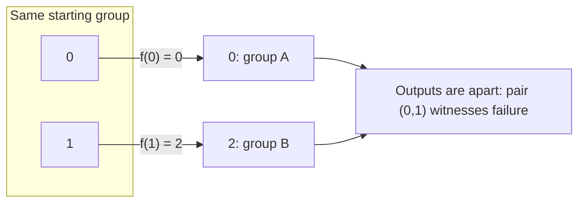
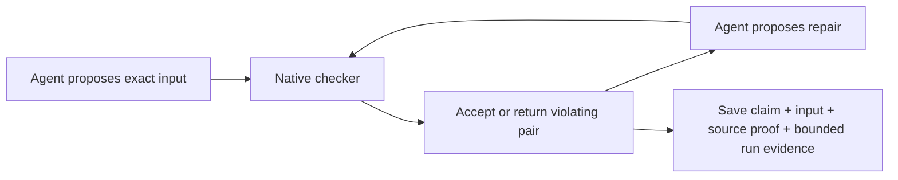

# A checker that explains why a grouping fails

The four-object checker implements the frozen
[`unary-grouping-v1` contract](../specs/unary-grouping-v1.json). Its Lean source
proves that acceptance is equivalent to preservation, proves both decoding round
trips, and proves that a returned pair really witnesses failure. The native
comparison and demo are reproduced by the commands below; their exact saved
build and outcomes are in the [run receipt](../evidence/grouping-checker-v1/summary.json).

The recorded run checked all **65,536 distinct inputs with zero disagreements**:
28,672 preserved groupings and 36,864 failures with valid witnesses. The source
build, kernel replay, all eleven axiom reports, and adapter probes passed. The
compiled output fault was detected on every input. All 31 Python controls passed
on Linux and Windows, including exact-evidence rejection cases.

## What the math means

A **rule** tells each object where to go. A **grouping** tells us which objects
we are allowed to treat as equivalent. A grouping is consistent with the rule
when objects that start together also finish together.

For our demo the rule is `f = [0,2,2,3]`: 0 stays at 0, 1 goes to 2, 2 stays at
2, and 3 stays at 3. Start with the groups `{0,1} | {2} | {3}`.



The checker returns `(0,1)`. This is a specific reason to reject the grouping:
the two input objects have the same label, but their outputs have different
labels. The repair merges the groups containing those outputs:

```text
Proposal                         Repaired proposal
{0,1} | {2} | {3}     →          {0,1,2} | {3}
labels [0,0,1,2]                  labels [0,0,0,2]
input ug4-v1:90e8                 input ug4-v1:80e8
REJECT: pair (0,1)                ACCEPT
```

The rule stays the same. Every member of `{0,1,2}` now maps into that group,
and 3 maps into `{3}`. Two groups remain, so the demonstration does not depend
on collapsing every object into a single group.

In symbols, with group labels `g`, the accepted condition is:

```text
For all x,y in {0,1,2,3}:
    g(x) = g(y)  implies  g(f(x)) = g(f(y)).
```

Equality of labels already defines an equivalence relation. Labels do not have
to be consecutive, and relabeling the same partition creates a different exact
input ID. The contract contains 256 rules × 256 label arrays = **65,536 inputs**.

## What Lean proves

The proof module is [`GroupingChecker.lean`](../lean/GroupingChecker.lean).
These declarations apply to every input in the specified domain:

| Declarations | Meaning |
| --- | --- |
| `decode_operation_bits`, `decode_label_bits` | The decoder implements the specified eight two-bit fields |
| `encode_decode`, `decode_encode` | A word and its decoded fields round-trip in both directions |
| `decodeInt_invalid`, `decodeInt_value`, `decodeInt_valid` | Integer bounds are explicit; valid values are preserved and invalid values are rejected |
| `labels_equivalence` | Equality of labels defines an equivalence relation |
| `check_iff` | The checker accepts exactly the preserved groupings |
| `witness_sound` | Every returned pair has equal input labels and unequal output labels |
| `rejected_has_witness` | Every rejected valid input has such a returned pair |

[`GroupingAudit.lean`](../lean/GroupingAudit.lean) requests 11 axiom reports.
The runner checks their exact declaration set and permits only `propext`,
`Classical.choice`, and `Quot.sound`. It also runs Lean's bundled kernel checker.
There are no placeholder proofs in this checker module.

## Reproduce the compiled experiment

Use Python 3.10+ and the toolchain pinned by `lean/lean-toolchain` (Lean 4.34.1).
The recorded build uses Linux x86-64. In a Linux shell, from the repository root:

```sh
python3 scripts/run_grouping_checks.py --out runs/grouping-reproduction
python3 scripts/grouping_tool.py demo \
  --receipt runs/grouping-reproduction/summary.json \
  --out runs/grouping-reproduction/demo.json
GROUPING_RECEIPT=runs/grouping-reproduction/summary.json \
  python3 -m unittest discover -s scripts -p 'test_grouping*.py' -v
```

Choose a new or empty run directory. Commit implementation changes before
creating evidenced results: the tool requires a clean recorded source tree
and verifies exact source-file hashes. Run directories are ignored by Git.
On Windows, run these native-build commands inside a Linux WSL distribution.
The Python reference and schema tests also run directly on Windows.

The runner builds `grouping_checker`, replays the proof module, audits axioms,
and obtains the native program's output for every word from 0 through 65,535.
The reference was written from the contract before its author read the Lean
implementation. It decodes with base-4 arithmetic and checks each block's image
labels; Lean scans pairs. The reference has separate exhaustive tests against
the literal mathematical condition. These are independent algorithms developed
with AI assistance in the same project, not external peer review.

The comparison checks coverage, decoded fields, round trips, Boolean results,
and the mathematical validity of every returned pair. It retains every
disagreement. Adapter probes separately test out-of-range and malformed strings.
A compiled fault control copies the project to an isolated run directory and
inverts the output wrapper's `preserves` field. The comparison must detect that
fault. This tests the path from executable output to comparison; it is not a
claim of exhaustive fault detection.

The receipt records exact source and executable hashes, toolchain and backend
versions, compiler/linker trace files, runtime dependencies, command logs,
coverage, and disagreements. Lake may reuse validated build outputs, which the
receipt explicitly distinguishes from a fresh compile. `binary.gz` preserves
the tested executable in each local or CI run. The recorded executable is also
distributed as an asset of the
[grouping checker pilot prerelease](https://github.com/Maverick0351a/finite-congruence-checks/releases/tag/grouping-checker-v1).
Git stores the compact transcript, logs, and receipt; it does not store that
large executable in source history.

## A local interface an agent can use

An agent proposes data, invokes the compiled checker, reads a concrete failure,
and proposes a repair. Only the checker decides whether the repaired grouping
is accepted:

```sh
python3 scripts/grouping_tool.py check --word 37096 \
  --receipt runs/grouping-reproduction/summary.json \
  --out runs/grouping-reproduction/proposal.json
python3 scripts/grouping_tool.py check --word 33000 \
  --receipt runs/grouping-reproduction/summary.json \
  --out runs/grouping-reproduction/repair.json
python3 scripts/grouping_tool.py validate runs/grouping-reproduction/repair.json
```

Instead of a word, pass `--input-json proposal.json` with:

```json
{"operation": [0, 2, 2, 3], "group_labels": [0, 0, 1, 2]}
```

Every array must contain exactly four integers in 0–3. Booleans, floats,
missing or extra fields, and duplicate JSON keys are rejected. A valid failed
grouping has `preserves: false`; it is different from malformed input or a tool
error. Native decimal parsing and JSON handling have tests but are outside the
pure Lean source theorem.

The [saved demo](../evidence/grouping-checker-v1/demo.json) is a reproducible
protocol replay using a fixed proposal and deterministic repair policy. It
records both actual native calls, the returned counterexample, the repair, and
the evidence for each outcome. It demonstrates the tool interaction an agent
can use; it is not an evaluation of an LLM's ability to discover repairs.
The repair routine itself has computational tests and no Lean correctness or
minimality proof. Its proposal earns acceptance only after another native check.

## Records and trust boundaries

[`grouping-result-v1.schema.json`](../specs/grouping-result-v1.schema.json)
describes the versioned result structure. `grouping_tool.py` additionally
checks relationships between fields and artifacts: input IDs, decoded fields,
claim IDs, exact contract bytes, theorem and binary hashes, source manifests,
audit logs, full transcript coverage, the cited case, and required scope limits.
The frozen input contract retains its original design-stage status; this
implementation document and run receipts record the later achievements.



**Source correctness** is established by the Lean theorems and kernel replay.
**Bounded executable agreement** is established by testing the identified build
on the complete encoded input domain. A machine-code refinement proof is a
separate future step. The compiler, runtime, input adapters, independent harness,
OS, and hardware remain part of the execution trust boundary.

Hashes identify exact bytes and expose changes; they do not authenticate an
author or prove that an arbitrary supplied receipt is truthful. Reproduction
executes the checks again. Offline `validate` reports whether the executable
archive was available and checked; a source checkout may omit that release
asset. Live `check` always hashes and executes the selected binary. A result about one rule and grouping does not prove
an entire congruence family, a minimum rule count, or a complete construction
search. Existing N5/B3 proofs still attach to their exact saved constructions.
