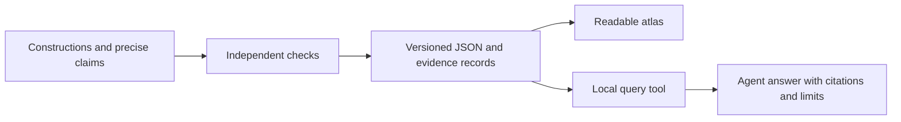

# An evidence interface for people and agents

The long-term direction is a reusable evidence service for mathematical work.
An agent should be able to retrieve a construction, compare it with alternatives,
inspect the supporting checks, and state exactly what follows. The atlas is the
first small implementation of that direction: a bounded domain whose records
can be reproduced and inspected completely.

The readable website and local query tool are two views of the same records.
The website explains them; the query tool returns structured data and citations.

Every arrow describes a data flow. An agent's answer is not itself a new proof.
New mathematical claims must return to the checking step before entering the
accepted evidence records.

## First contract

- **Identity:** entry IDs identify exact relation families under a specified
  labeling convention. Shape keys have a versioned canonicalization algorithm.
  Display names and snapshot-local type numbers are not permanent identities.
- **Meaning:** every minimum names the fixed carrier, exact congruence relations,
  and allowed operation arity. Zero-operation algebras are explicitly included.
- **Evidence:** each claim carries assumptions, limits, and citations to exact
  records. Content hashes identify the dataset behind a response.
- **Failure:** unknown identifiers, stale evidence, and malformed requests must
  fail explicitly. An empty in-scope result does not establish impossibility
  outside the catalog.
- **Reproduction:** accepted records are deterministic exports checked in CI.
  The independent verifier derives the classification using different routines.

See the [query contract](ATLAS_QUERY.md) for commands, identifiers, and response
fields. The [retrieval evaluation](ATLAS_QUERY_EVALUATION.md) records a concrete
agent task and checks its citations and scope.

## What makes this useful infrastructure

The near-term success measure is correct evidence use. For example, an agent
should find two C4 representations with different minimum rule counts, cite
their individual records, and explain that the minima apply to those exact
representations. It should also distinguish comparing different carrier sizes
from comparing constructions on the same number of objects.

Further evaluations should include unsupported claims, deliberately corrupted
records, counterexample retrieval, and questions with no matching result.
Measure answer correctness, citation validity, scope errors, and the ability to
reproduce a retrieved result. A successful small test does not establish that
the interface improves general AI reasoning.

## Growth decisions

Keep the first interface local and dependency-free. Add an API or MCP adapter
when another application needs remote queries, while preserving the same
record identities and claim meanings. Add a database when measured record size
or query cost justifies it. Evaluate adapters against the same fixtures before
publishing them.

Cytoscape.js now renders the construction-to-shape relationships in the
[interactive map](ATLAS_MAP.md). It consumes the same atlas and claim records;
the inspector exposes claim IDs and opens the selected entry's rules and
evidence. The graph uses versioned shape keys from the claims, and its positions
carry no mathematical meaning. The small grouping diagrams remain SVG. Both
views use local assets, including a pinned, licensed copy of Cytoscape.js.

External replication, reviewed mathematical extensions, and versioned releases
are the next trust milestones. A service used by other projects will also need
explicit compatibility and deprecation policies, resource limits, and a record
of which consumers rely on each version. The current release is a foundation
for testing that direction, with no claim of broad adoption or production scale.
