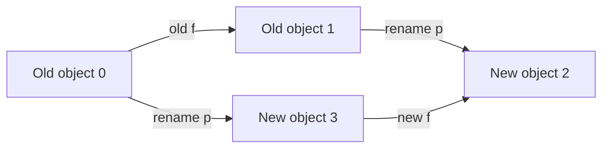

# When can we reuse a proof?

Renaming an object should not change how it behaves. But that works only if we
rename the rules and the groupings consistently. The
[interactive reading guide](https://maverick03511-finite-congruence-checks.static.hf.space/context-n5.html#reuse)
shows this connection in its saved N5 lesson.

## One result, two presentations

The original construction has four objects and two rules:

| Input | 0 | 1 | 2 | 3 |
|---|---|---|---|---|
| f | 1 | 0 | 3 | 2 |
| g | 0 | 1 | 0 | 1 |

A grouping works when objects together before a rule are still together after
that rule. Exactly five of the 15 possible groupings work. Their order by
inclusion is the pentagon shape N5.

Now exchange labels 0 and 3, and exchange 1 and 2. Call this map **p**. Keep the
rule names f and g. The new rule must satisfy `new_f(p(x)) = p(old_f(x))`, and
likewise for g. Either route through this square must reach the same object:



The resulting rules are:

| Input | 0 | 1 | 2 | 3 |
|---|---|---|---|---|
| new f | 1 | 0 | 3 | 2 |
| new g | 2 | 3 | 2 | 3 |

For example, `{0,1} | {2} | {3}` becomes `{0} | {1} | {2,3}`. The proof
transports **every valid grouping**, and also proves that there are no extra
ones, that all five are distinct, and that their inclusion order is preserved.
The generic transport theorem already existed; this is another exact application.

The page also offers the earlier [rotation with a rule-name swap](N5_RENAMING.md).
That transformation reindexes the rules. The new reverse-label example preserves
their names. Neither result attaches a proof to a different construction merely
because it has an N5-shaped diagram.

## Three different problems

| Change | What fails? | What follows? |
|---|---|---|
| Rename the grouping but keep the original rules | Original g sends together objects 2 and 3 to separate objects 0 and 1 | This grouping fails for those rules |
| Keep the rotation's target rules but claim that rule names were not swapped | The declared rule correspondence equation | The target still has the same five groupings; this proposed correspondence is wrong |
| Replace the reverse example's theorem with `B3.all_relations` | The exact evidence binding | The supplied reference does not support this claim; this does not make its conclusion false |

These are deliberate controls. They are not observed agent errors. Browser
calculations explain the finite examples; the browser does not execute Lean.

## Retrieve the exact record

```sh
python scripts/query_context.py explain context:family-206:saved-n5:reverse-labels:v1 --out reverse-n5.json
python scripts/query_context.py check reverse-n5.json
```

The downloaded record on the page is the same query envelope. Its construction
ID is `saved:family-206:n5:reverse-labels:v1`. The original rotation's ID and
records remain unchanged. `compare` still compares the saved N5 and the original
atlas N5 entry; it has not acquired a different meaning.

`check` performs curated exact-record matching. A fresh Lean run checks that the
referenced theorem has the required mathematical type. Neither operation decides
the applicability of arbitrary theorems to arbitrary claims.

## Reproduce the proof

Install Python 3.10+ and the pinned Lean 4.34.1 toolchain through elan. On Linux,
macOS, or WSL, from a fresh clone of this repository:

```sh
python scripts/n5_reverse_transfer.py run --out runs/n5-reverse-labels-fresh
```

The command builds the sibling project, audits theorem axioms, invokes kernel
replay, and checks deliberately mismatched bindings. Its receipt identifies the
source files, configurations, logs and outcomes. No network service or API key is
needed once the toolchain is installed. The local dependency chain is the new
project, the existing renaming project, and the original finite-algebra project.

To check saved evidence and the presentation separately:

```sh
python scripts/n5_reverse_transfer.py replay
python scripts/n5_transfer.py replay
python scripts/build_n5_reuse.py --check
python -m unittest discover -s scripts -p 'test_n5_reverse_transfer.py' -v
python -m unittest discover -s scripts -p 'test_n5_reuse.py' -v
node scripts/check_n5_reuse.cjs
```

The immutable source anchor pins each linked source and receipt to one Git
revision. The exporter checks both the working files and that revision's Git
blobs before producing the page's
JSON and JavaScript. Hashes identify artifacts; they do not prove mathematical
statements. The Python exporter, browser code, and compiler are outside the
source-level mathematical proof. Independent finite enumeration checks all 15
groupings as a separate implementation check.

This milestone demonstrates a controlled reuse of a mathematical result. Agent
reasoning benefits remain unmeasured, and the controlled model benchmark remains
paused.
