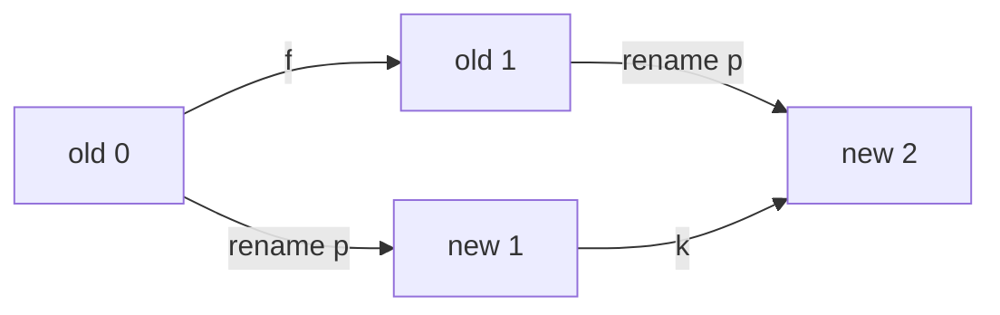

# Reusing one result after a justified renaming

The saved N5 proof can be reused when the objects, rules, and groupings move
together under a specified bijection. This example records that transformation
and checks its mathematical justification in Lean.

## What changes, in plain language

Imagine replacing every object's name according to this key:

| Old object | New name |
| --- | --- |
| 0 | 1 |
| 1 | 2 |
| 2 | 3 |
| 3 | 0 |

The map is `p = [1,2,3,0]`; its inverse is `[3,0,1,2]`. We also swap the two
rule symbols: target rule 0 corresponds to source rule 1, and vice versa.
This is **carrier renaming with rule reindexing**. It does not preserve each
original named operation symbol.

| Rule | Source outputs at 0,1,2,3 | Corresponding target rule | Target outputs at 0,1,2,3 |
| --- | --- | --- | --- |
| f | `[1,0,3,2]` | k (target rule 1) | `[3,2,1,0]` |
| g | `[0,1,0,1]` | h (target rule 0) | `[2,1,2,1]` |

For example, source rule `f` sends 0 to 1. The renamed rule `k` must therefore
send the new name of 0 (which is 1) to the new name of 1 (which is 2):



Both routes must end at the same object. This is checked for **every object
and both rules**, not just the example drawn here.

The grouping `{0,1} | {2} | {3}` becomes `{1,2} | {3} | {0}`. The two
objects that were together stay together; only their names change. All five
source groupings move as follows. Blocks are reordered for readability.

| Source grouping | Renamed grouping |
| --- | --- |
| `{0} \| {1} \| {2} \| {3}` | `{0} \| {1} \| {2} \| {3}` |
| `{0,1} \| {2} \| {3}` | `{0} \| {1,2} \| {3}` |
| `{0,1} \| {2,3}` | `{0,3} \| {1,2}` |
| `{0,2} \| {1,3}` | `{0,2} \| {1,3}` |
| `{0,1,2,3}` | `{0,1,2,3}` |

If we rename the groupings but keep the old rules, the second row fails:
old `f` sends the together pair `(1,2)` to `(0,3)`, which are separate in that
renamed grouping. That is an inconsistent transformation.

## Why the result carries over

Write `σ(j)` for the source rule corresponding to target rule `j`.
Our exact rule map is `σ = [1,0]`, **target index to source index**. Define

```text
target[j](p(x)) = p(source[σ(j)](x))
renamed_relation(u,v) = original_relation(p⁻¹(u), p⁻¹(v))
```

[Renaming.lean](../lean/renaming/Renaming.lean) proves compatibility in both
directions for every bijection on `Fin 4`, any two unary operations, and every
relation. It also proves relation round trips and inclusion preservation and
reflection. A separate theorem permits swapping the two rule symbols.

[N5Renaming.lean](../lean/renaming/N5Renaming.lean) applies these results to
the existing `FiniteCongruenceChecks.N5.all_relations` proof. It derives:

- **Completeness:** every target congruence is one of the five transported ones,
  and every listed grouping is a congruence.
- **Order:** one transported grouping is contained in another exactly when
  their source labels have that order in N5.
- **Distinctness:** two transported groupings coincide only when their N5
  indices coincide.

Together these establish exactly five congruences ordered as N5. The target
classification is obtained from the source theorem through transport. Finite
`decide` checks bind displayed tables to the definitions; they are not a new
enumeration of all target relations.

## What the atlas accepts

The new construction has its own ID, `saved:family-206:n5:rotate-and-swap:v1`.
Its [claim record](../evidence/n5-renaming-v1/claim.json) identifies the original
construction, both directions of the object map, the rule map, the grouping
index map, complete source and target tables, conclusions, and proof references.
Grouping arrays use canonical labels in order of first appearance; the numbers
name blocks, rather than adding mathematical information.

The [generated binding](../lean/renaming/N5RenamingBinding.lean) checks full
table equalities, inverse laws, rule and grouping correspondence, and the
classification, order, and distinctness types. Lean elaborates the named proof
against the required mathematical statement. A name or file hash is insufficient.

```sh
python scripts/query_context.py explain context:family-206:saved-n5:renaming:v1 --out renamed-n5.json
python scripts/query_context.py check renamed-n5.json
```

This command retrieves one registered, proved transfer. It still rejects edits
to a saved record, including other legitimate transformations that have not
been registered with their own evidence. It does not discover arbitrary
isomorphisms or decide whether any supplied theorem applies.

The existing atlas entry `n4-E16709` uses different operation tables. This new
proof does not transfer to that entry merely because it also has N5 shape.
Operation minimality and the graph certificate are separate claims.

## Reproduce and inspect

Requires Git, Python 3.10+, and Lean's `lake`. The project pins Lean 4.34.1,
imports the existing core project by an explicit local path, and needs no
external Lean packages. Use Linux, macOS, or WSL for the full run.

```sh
git clone https://github.com/Maverick0351a/finite-congruence-checks.git
cd finite-congruence-checks
git checkout main
git rev-parse HEAD
python scripts/n5_transfer.py run --out runs/n5-renaming-fresh
python scripts/n5_transfer.py replay --out runs/n5-renaming-fresh
python -m unittest discover -s scripts -p 'test_n5_transfer.py' -v
```

The nine recorded stages check the Lean version, build, 22 declaration axiom
reports, kernel replay, and five rejected bindings: a changed rule, changed
grouping, inconsistent object map, unswapped rule map, and unrelated B3 theorem.
The unswapped-rule-map control matters because swapping two rules does not
change the congruence family; a separate conjugation equation must justify
their declared correspondence.

The [saved receipt](../evidence/n5-renaming-v1/summary.json) contains exact
commands, source and artifact hashes, timings, axiom reports, and all control
sources and errors. `replay` checks that saved evidence without running Lean.
Receipts are reproducibility records, not authenticated attestations. Python
export and validation code remain outside the formal correctness claim.

On 2026-10-19, the local Lean run passed all nine stages. Twelve focused Python
tests also passed, including direct compatibility and order checks over all
24 object permutations, both rule orders, and all 15 partitions. Those finite
checks exercise the exporter; the general transport theorem supplies the proof.
CI runs the same proof command from a fresh checkout and uploads its evidence.

Independent review found that the imported core project's source directory could
be redirected without failing the configuration gate. The runner now pins both
packages' complete Lake configurations and manifests and rejects alternate
`lakefile.lean` files. Regression controls reject five configuration changes
before a proof run starts. The proof and receipt were rerun after this fix.

The theorem, record binding, and agent evaluation remain distinct achievements.
The four benchmark answering sessions and model-training work remain paused.
