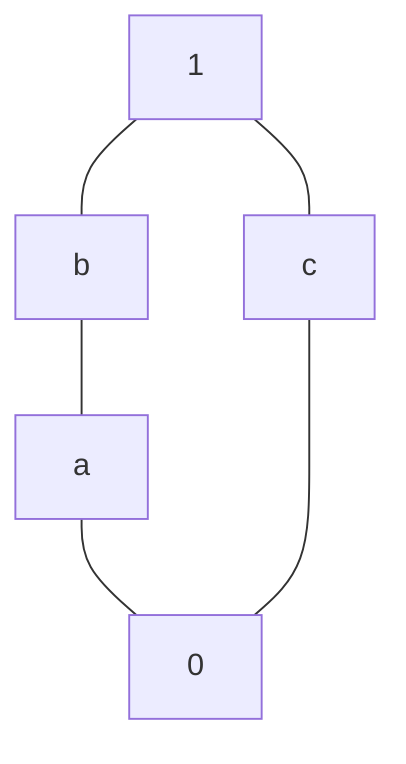

# The saved N5 example and its sources

The saved example is an algebra on **four points with two unary operations**. Its complete collection of valid groupings has five members, ordered as the pentagon lattice N5. The four points belong to the algebra; the five lattice elements name groupings of those points.

A grouping means a partition into nonempty, disjoint blocks. It is valid for this algebra when each operation sends any two points in the same block to points in the same block. This is the usual congruence condition for unary operations. The [primary paper, §1.1, p. 4](https://github.com/openai/math/blob/1581d4cbdd69a0faf34b2089614fe2a814316a6a/preprints/Finite-Congruence-Lattices-Characterization-and-Undecidability-September-24-2026/paper.pdf) concerns the **full** congruence lattice `Con(A)`: all compatible equivalence relations, ordered by inclusion. Listing some valid partitions would therefore be insufficient; completeness is part of the claim.

The interactive explanation is in [the N5 source-context page](../space/context-n5.html), with a separate [machine-readable context record](../space/n5-context.json). This note describes the saved construction and the scope of its evidence.

The carrier is `V = Fin 4`, represented by `{0,1,2,3}`. The selected operation tables are:

| Input point | 0 | 1 | 2 | 3 |
| --- | ---: | ---: | ---: | ---: |
| `f = op1` | 1 | 0 | 3 | 2 |
| `g = op2` | 0 | 1 | 0 | 1 |

Thus `f` swaps 0 with 1 and 2 with 3. The operation `g` fixes 0 and 1, sends 2 to 0, and sends 3 to 1. These are the tables in [the N5 minimization record](../evidence/minimized-algebras.json), under the certificate `N5-witness.json`, and in [the generated Lean data](../lean/CertificateData.lean#L68). The carrier definition is at [line 15](../lean/CertificateData.lean#L15).

The five valid groupings are:

| Lattice label | Blocks of the partition | Saved partition vector |
| --- | --- | --- |
| `0` (bottom) | `{0} \| {1} \| {2} \| {3}` | `[0,1,2,3]` |
| `a` | `{0,1} \| {2} \| {3}` | `[0,0,1,2]` |
| `b` | `{0,1} \| {2,3}` | `[0,0,1,1]` |
| `c` | `{0,2} \| {1,3}` | `[0,1,0,1]` |
| `1` (top) | `{0,1,2,3}` | `[0,0,0,0]` |

In a partition vector, equal entries mean membership in the same block; the entries are block names. In the first column, `0` and `1` are lattice labels, distinct from the carrier points with the same printed names. The correspondence is saved in `threshold_partitions` in [minimized-algebras.json](../evidence/minimized-algebras.json#L2440).

Moving upward merges blocks. The cover relations are `0 < a < b < 1` and `0 < c < 1`; `c` is incomparable with both `a` and `b`.



All five partitions are preserved by both operations. Equality and the universal grouping always are. For `a`, `f` preserves the block `{0,1}` and exchanges the two singleton blocks, while `g` sends each block into a block. For `b`, `f` preserves each of its two blocks and `g` sends both into `{0,1}`. For `c`, `f` exchanges the two blocks and `g` sends them into `{0}` and `{1}`, respectively, each contained in the appropriate block of `c`.

A useful invalid proposal is `{0} | {1} | {2,3}`, encoded `[0,1,2,2]`. Its points 2 and 3 are grouped together, but `g(2) = 0` and `g(3) = 1` are in different blocks. The pair `(2,3)` is therefore a concrete violation. This also explains why merging 2 with 3 forces a merge of 0 with 1.

To see why there are no other valid groupings, write `x ~ y` when two points share a block and split into three cases:

1. If `0 ~ 3` or `1 ~ 2`, applying `f` forces the other pair. Applying `g` forces `0 ~ 1`. Transitivity then puts all four points in one block.
2. Otherwise, if `0 ~ 2` or `1 ~ 3`, applying `f` forces both pairs. These are exactly the two blocks of `c`. Any additional identification joins those blocks, giving the universal grouping.
3. If no pair crosses between `{0,1}` and `{2,3}`, the only possible nontrivial pairs are `0 ~ 1` and `2 ~ 3`. Preservation under `g` forces `2 ~ 3` to imply `0 ~ 1`. The possibilities are therefore bottom, `a`, and `b`.

This argument is a direct explanation from the saved tables. The formal proof independently classifies every congruence of those tables.

The saved graph connects this example to the source theorem. Its vertices are the same four points, and its pair colors are:

| Color | 0 | 1 | 2 | 3 |
| --- | --- | --- | --- | --- |
| **0** | bottom | a | c | top |
| **1** | a | bottom | top | c |
| **2** | c | top | bottom | b |
| **3** | top | c | b | bottom |

The JSON stores the colors as indices into `["0","a","b","c","1"]`; see [N5-witness.json](../evidence/N5-witness.json). For a lattice label `q`, the threshold relation groups `x` and `y` exactly when `color(x,y) <= q`. These thresholds produce the five partitions above. The Lean definition is [`N5.theta`](../lean/FiniteCongruenceChecks.lean#L140).

The [paper's Definition 2.1 and Theorem 2.2, §2, pp. 7–8](https://github.com/openai/math/blob/1581d4cbdd69a0faf34b2089614fe2a814316a6a/preprints/Finite-Congruence-Lattices-Characterization-and-Undecidability-September-24-2026/paper.pdf) describe the colored-graph characterization. In the pinned Lean formulation, an admissible placement is a total map of vertices that can only decrease pair colors. It may collapse vertices; it need not be a permutation. The witness requires symmetric colors, bottom exactly on equal vertices, a join triangle inequality, detection of the lattice order, and a seed-connectivity condition. For every nonempty finite set of ordered seed pairs, every pair whose color lies below the join of the seed colors must be connected by a finite path of images of seed pairs under admissible placements. Connectivity is equivalence closure, including zero-length paths.

Those are the definitions of [`Admissible`, `Marked`, `Connected`, and `IsGraphWitness`](../lean/upstream/OAI/Algebra/Universal/GraphCriterion.lean#L20), also available in the [pinned upstream source](https://github.com/openai/math/blob/1581d4cbdd69a0faf34b2089614fe2a814316a6a/lean/OAI/Algebra/Universal/GraphCriterion.lean#L20). The theorem's forward direction colors a pair by the least congruence containing it, transported through the lattice isomorphism. Its backward direction uses all admissible self-maps as unary operations and proves that the threshold relations exhaust the resulting congruences. The saved N5 graph has 12 admissible maps; the concrete algebra above uses a selected two-map subset with the same complete congruence family.

The completed upstream theorem has this signature:

```lean
theorem graph_criterion (Lat : Type) [Fintype Lat] [Lattice Lat] [OrderBot Lat] :
    Representable Lat ↔ HasGraphWitness Lat
```

Its body is in [the local pinned solution](../lean/upstream/OAI/Algebra/Universal/GraphCriterion.lean#L291) and [upstream at the fixed revision](https://github.com/openai/math/blob/1581d4cbdd69a0faf34b2089614fe2a814316a6a/lean/OAI/Algebra/Universal/GraphCriterion.lean#L291). The assumptions provide a finite lattice and a bottom element. `Representable` means there exists a positive carrier size and a finite-signature algebra on `Fin size`, together with an order isomorphism from `Lat` onto its entire congruence order. Operations have finite arity, with nullary operations permitted. `HasGraphWitness` likewise requires a positive finite vertex count, without imposing a fixed upper bound. See [Congruence.lean](../lean/upstream/OAI/Algebra/Universal/Congruence.lean#L17) and its [pinned upstream copy](https://github.com/openai/math/blob/1581d4cbdd69a0faf34b2089614fe2a814316a6a/lean/OAI/Algebra/Universal/Congruence.lean#L17).

For the concrete N5 tables, the local proof includes these exact statements inside `FiniteCongruenceChecks.N5`:

```lean
theorem all_relations (r : V → V → Prop) :
    IsPropCongruence op1 op2 r ↔ ∃ a, ∀ x y, r x y ↔ theta a x y = true

theorem order_exact : ∀ a b : Fin 5,
    le a b = true ↔ Included (theta a) (theta b)
```

Here `V`, `op1`, `op2`, `le`, and `theta` are the fixed saved definitions. `IsPropCongruence` requires equivalence and preservation under both operations. [`finite_classification`](../lean/FiniteCongruenceChecks.lean#L142) checks the 64 symmetric reflexive Boolean relations on four points with kernel reduction via `decide`. [`relation_complete`](../lean/FiniteCongruenceChecks.lean#L62) covers every equivalence relation; [`all_relations`](../lean/FiniteCongruenceChecks.lean#L159) lifts the result to arbitrary Prop-valued relations. The classification therefore establishes all congruences, rather than only the five candidate relations.

The bridge then states, inside `FiniteCongruenceChecks.UpstreamBridge.N5`:

```lean
noncomputable def congruenceOrderIso : Label ≃o Congruence algebra
theorem principalColor_eq : principalColor congruenceOrderIso = color
theorem isGraphWitness : IsGraphWitness color
theorem hasGraphWitness : HasGraphWitness Label
theorem representable : Representable Label
```

[`Label`](../lean/upstream/ConcreteBridge.lean#L84) carries the saved N5 order, avoiding the ordinary numeric order on `Fin 5`. [`algebra`](../lean/upstream/ConcreteBridge.lean#L128) has exactly the two unary operations above. The [bridge proof](../lean/upstream/ConcreteBridge.lean#L130) identifies the saved coloring with the actual principal-congruence coloring and derives the complete upstream witness predicate, including every nonempty finite seed set.

Three source roles should be kept separate:

| Source or evidence | What it establishes |
| --- | --- |
| [Comparator challenge](../lean/comparator/ComparatorChallenges/FiniteCongruenceGraph.lean#L57), also copied in [reference/](../reference/FiniteCongruenceGraph.lean#L57) | The target statement and definitions. Its `graph_criterion` intentionally ends in `sorry`; this file is not the completed solution. |
| [Completed upstream solution](../lean/upstream/OAI/Algebra/Universal/GraphCriterion.lean#L291) and [official comparator receipt](../lean/comparator/evidence/receipt.json) | The selected general graph-characterization theorem passed the original comparator. The placeholder solution was rejected for `sorryAx`, and a changed statement was rejected for mismatch. |
| [Local concrete classification](../lean/FiniteCongruenceChecks.lean), [bridge](../lean/upstream/ConcreteBridge.lean), and [bridge-run receipt](../lean/evidence/bridge-run/result.json) | The exact saved N5/B3 constructions have their stated full congruence orders and satisfy the pinned upstream graph predicate. This is a separate check from the official comparator. |

The pinned [upstream challenge](https://github.com/openai/math/blob/1581d4cbdd69a0faf34b2089614fe2a814316a6a/lean/ComparatorChallenges/FiniteCongruenceGraph.lean#L57) is what the `source` field in `N5-witness.json` identifies. That field identifies the predicate being checked; it does not attribute the locally saved operation tables or their discovery to the challenge file.

The existing receipts record Lean 4.34.1 builds, kernel replay, source hashes, and axiom inspection. The concrete Boolean classification reports `propext` and `Quot.sound`; its Prop-valued extension, bridge, and upstream theorem also use `Classical.choice`. The [axiom report](../lean/evidence/bridge-run/axioms.log) contains neither `sorryAx` nor `Lean.ofReduceBool` for these declarations. The [comparator configuration](../lean/comparator/ComparatorChallenges/FiniteCongruenceGraph.json) permits the three stated axioms and disables Nanoda. These records rely on the identified Lean runtime, dependencies and imported cache, tools, operating system, and hardware. They are targeted checks, not a verification of the whole upstream corpus. See [the verification guide](LEAN_VERIFICATION.md) and [comparator README](../lean/comparator/README.md) for the recorded environments and reproduction boundaries. Preparing this explanation did not rerun those checks.

The operation-minimization certificate additionally reports that two unary operations are minimal for this fixed carrier and exact saved relation family. That computational optimization result has a narrower scope than arbitrary realizations or signatures, and it is separate from the Lean proof that these particular two operations yield exactly N5.

The canonical atlas entry `n4-E16709` requires one more identity distinction. The permutation from saved points to atlas points is `[1,3,2,0]`: saved 0 maps to atlas 1, saved 1 to atlas 3, saved 2 to atlas 2, and saved 3 to atlas 0. Under this relabeling, the five saved partitions match the atlas grouping family. Conjugating each saved operation by the same permutation gives:

| Construction, using atlas point labels | Operation tables |
| --- | --- |
| Relabeled saved algebra | `[2,3,0,1]`; `[3,1,1,3]` |
| Atlas entry `n4-E16709` | `[1,3,3,1]`; `[2,3,0,1]` |

The [atlas data](../space/atlas-data.json) therefore displays a different operation list under this comparison, despite the matching grouping family. The concrete N5 proof badge applies to the saved tables and their proved bridge. It must not be transferred to the atlas operation list merely because both are named N5 or have the same groupings. The atlas entry retains its own [computational evidence and method](ATLAS.md); transporting or proving a formal statement about its displayed operations would require an explicit additional argument.

Family 206 supplies the graph-characterization context. Its [local scope note](../reference/206.md) and [pinned upstream scope note](https://github.com/openai/math/blob/1581d4cbdd69a0faf34b2089614fe2a814316a6a/lean/docs/206.md) explicitly exclude the paper's undecidability and subgroup-interval conclusions from the selected formalization. This example supports neither a general representation claim for every finite lattice nor a validation of those stronger paper claims, and no mathematical novelty is claimed for the example.

Family 376 is a separate source context. The local Turing-machine work extracts machine definitions from [the pinned `NavierStokesAlternating.lean` challenge](https://github.com/openai/math/blob/1581d4cbdd69a0faf34b2089614fe2a814316a6a/lean/ComparatorChallenges/NavierStokesAlternating.lean#L10-L66), with the exact extraction bound by [its source manifest](../lean/tm/source/manifest.json). Its [step lemmas and translation checks](TM_TRANSLATION_CHECKS.md) concern that machine fragment; its [pair atlas](TM_ATLAS.md) records separately scoped observations. They do not establish the surrounding PDE statements, the N5 result, or the family 206 graph theorem. Evidence stays attached to its exact definitions, construction, and claim.

## Reproduce and maintain this context layer

The context is a separate sidecar using the existing claim fields: exact values,
evidence status, scope, assumptions, limits, and citations. It leaves the existing
atlas evidence schema and frozen semantic benchmark unchanged. Print the record
with `python scripts/build_n5_context.py --show`; the same information is available
to the browser in `space/n5-context-data.js` and for other readers in
`space/n5-context.json`.

```sh
python scripts/build_n5_context.py --check
python -m unittest discover -s scripts -p 'test_n5_context.py' -v
node scripts/check_n5_context.cjs
python -m http.server 8786 --bind 127.0.0.1 --directory space
# Open http://127.0.0.1:8786/context-n5.html
```

The builder pins ten source hashes to local revision
`cddf9cf1c2d06df36bc516fb0b461daf6365920e` and links upstream sources at
`1581d4cbdd69a0faf34b2089614fe2a814316a6a`. Local text hashes normalize CRLF to
LF; the paper's hash is over its raw PDF bytes. Changing a cited local file makes
generation fail until its revision and hash are explicitly reviewed. The builder
also checks the saved comparator acceptance and both rejection controls, binds
the bridge receipt to its source files, enumerates the 15 partitions, and checks
the stated atlas renaming. These are data-integrity and finite computational
checks; they do not prove that a prose explanation preserves meaning.

The Cytoscape map is a curated reading map. A solid edge identifies a stated
proof relationship; a dashed edge provides an illustration; a dotted edge
identifies shared definitions or statement comparison. These links were reviewed
against the cited files, not extracted from Lean elaborated dependencies. In
particular, the concrete bridge uses the principal-color construction; it does
not depend on the general `graph_criterion` equivalence theorem. Use elaborated
declarations for a future automatic proof-dependency layer.

## Work record — 18 October 2026

- Inspected the pinned paper's definition and graph-criterion passage, source
  scope note, Lean statements, saved tables, and existing verification receipts.
- Wrote the three-case completeness explanation, interactive partition check,
  color table, source selector, typed reading map, and exact atlas correspondence.
- Independent review identified that calculating fresh hashes while retaining
  old commit links could mislabel modified sources. Replaced that behavior with
  fixed source pins and explicit comparator-result checks. Verified all ten pins
  against the Git objects at the named revision.
- Six Python tests pass, including changed-proof, changed-certificate,
  changed-receipt, failed-comparator, and incorrect-correspondence controls.
  The Node check compares every partition against a separately written block-image
  oracle. Existing atlas, map, and Turing UI checks also pass.
- Browser inspection checked the working and failing partition explanations,
  source selection, expandable proof links, rendered map, and navigation to the
  exact N5 atlas entry. The 412-pixel view had no horizontal page overflow and no
  captured console warnings or errors. This records the viewport actually inspected;
  it is not a complete accessibility or device audit.
- This work reused the existing Lean receipts; it did not rerun Lean or add a new
  formal theorem. No benchmark answering session was run. The four answering
  sessions and reserved task families remain paused and untouched.
