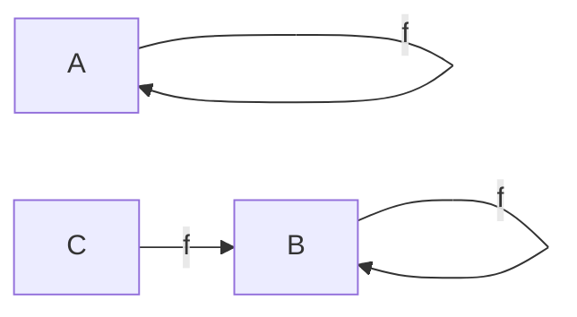
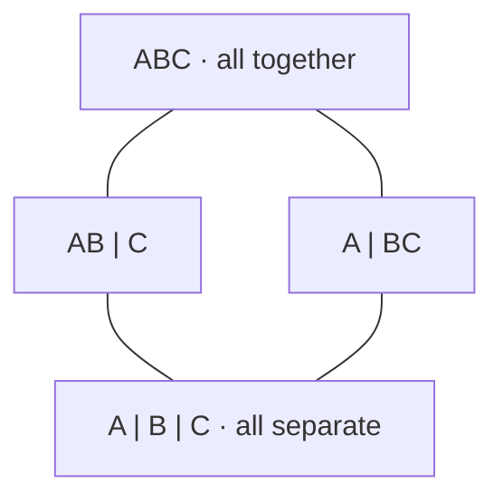
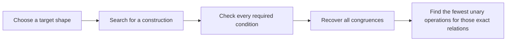

# The math, one small example at a time

**Our tool looks for small systems whose rules permit exactly a chosen pattern
of consistent groupings. It then checks the result and records the evidence.**

You can understand the basic question with three objects and one rule. No prior
knowledge of abstract algebra is needed for this example.

## 1. Start with objects and a rule

Imagine three objects called **A, B, and C**. A rule named `f` sends each object
to an object:

| Input | Output |
|:--|:--|
| A | A |
| B | B |
| C | B |



**Read this diagram:** each node is an object. Each arrow means “apply the
rule once.” The loops show that A and B stay where they are; C moves to B.

The set of objects is called the **carrier**. A rule with one input is a
**unary operation**. The objects together with their operations form an
**algebra**. Here, “algebra” means a system of objects and rules; it need not
involve solving equations for x.

## 2. Which groupings respect the rule?

Suppose we group B and C together while keeping A separate:

```text
Before applying f:      [ A ]   [ B  C ]
After applying f:       [ A ]   [ B  B ]
```

This grouping works. The two objects we treated as equivalent, B and C, still
have equivalent outputs. The repeated B records the output from B and from C;
it is a list of outputs, not a new partition. That lets us apply the rule to a
whole group without the resulting group depending on which member we choose.

Now try grouping A and C together while keeping B separate:

```text
Proposed groups:        [ A  C ]   [ B ]
                            |
                    apply f to A and C
                            |
Outputs:               A goes to A; C goes to B
                       Their outputs are in DIFFERENT groups.
```

That grouping fails: choosing A or C from the same group gives outputs in
different groups.

A **partition** divides all the objects into nonempty, nonoverlapping groups.
A partition that respects every operation of the algebra is a **congruence**.
The rule is:

> Inputs in the same group must have outputs in the same group.

Outputs may land in a different group from their inputs; they just have to
stay together. In notation, for every unary operation `f`:

$$x \sim y \quad\Longrightarrow\quad f(x) \sim f(y).$$

Here, $x \sim y$ means “x and y belong to the same group.”

## 3. We can check every possibility

Three objects have exactly five partitions. A vertical bar below separates
groups; `AB | C` means “A and B together, C separately.”

| Partition | Respects f? | Reason |
|:--|:--|:--|
| `A \| B \| C` | Yes | Each group contains just one object. |
| `AB \| C` | Yes | A and B map to A and B, still in the AB group. |
| `A \| BC` | Yes | B and C both map to B. |
| `AC \| B` | **No** | A and C map to A and B, which are in different groups. |
| `ABC` | Yes | Every output is in the single group. |

So this algebra has **exactly four congruences**. “Exactly” matters: finding
four that work would be insufficient if an unwanted fifth grouping also worked.

## 4. Draw the pattern made by those groupings



**Read this diagram:** now each node is a whole grouping, rather than one
object. Going upward merges groups. A line joins two allowed groupings when
there is no allowed grouping strictly between them. These lines describe
refinement; they are not operation arrows.

The two middle groupings are incomparable: neither can be obtained from the
other solely by merging groups. Both sit above “all separate” and below
“all together.” This four-node shape is called **B2**, the Boolean square.

Why call it a **lattice**? Any two nodes have both a greatest common refinement
and a least common coarsening among the allowed groupings. These are called
their **meet** and **join**. For the two middle nodes, the meet is the bottom
node and the join is the top node.

Our example uses **three objects**, **one operation**, and **four congruences**.
These are three different quantities. One operation is also the minimum for
this exact grouping family: with no operations, all five partitions would be
allowed.

This is the saved B2 construction with friendlier labels: `A = 2`, `B = 0`,
and `C = 1`. The stored operation is `(0,0,2)`, meaning that inputs 0, 1, and
2 have outputs 0, 0, and 2. See the [B2 graph certificate](../evidence/B2-witness.json)
and [selected operations](../evidence/minimized-algebras.json).

## 5. What the project adds

The research question runs this example in reverse:

> Given a desired lattice shape, can we build a small algebra whose complete
> set of congruences has that shape?



Our search encodes candidate constructions as colored graphs, following a
criterion selected from **family 206 of OpenAI's math corpus**. The colors are
lattice elements: they encode how pairs of carrier objects become equivalent
at different levels of the target lattice. A separate implementation checks
every required graph condition. We then enumerate partitions and unary maps to
recover the actual congruences and minimize the operation list.

The graph used in that search is a third kind of diagram. Its vertices are
carrier objects and its pair colors are construction data. The square above
instead displays the resulting lattice of groupings.

## 6. What a result tells us

| Result | Plain-language meaning |
|:--|:--|
| A positive construction | Here are the objects and rules; all their consistent groupings match the target. |
| An exhaustive bounded search | Every candidate within the stated search space was considered. |
| No example through four objects | That bounded search found none. A larger construction remains possible. |
| Minimum two unary operations | Two rules suffice, and fewer cannot preserve exactly these relations on this carrier. |
| A concrete Lean proof | Lean checks a precise mathematical statement about specified data under its recorded assumptions. |

Our formal bridge proves that the exact saved **N5 and B3 graphs** satisfy the
selected upstream graph-witness predicate. Separately, the pinned upstream
theorem passed its official comparator. The [claim ledger](CLAIMS.md) and
[Lean record](LEAN_VERIFICATION.md) state the precise coverage and assumptions.
This supports a specific part of the corpus; coverage of the entire corpus
would require much more work.

When comparing constructions, keep the carrier, exact groupings, and permitted
kind of operations visible. Two constructions can have the same abstract
lattice shape while needing different numbers of unary operations for their
particular relations.

## A short showcase script

“Imagine a few objects and rules that transform them. Some ways of grouping
the objects stay consistent when those rules run. Those groupings form a
mathematical shape called a congruence lattice. Our tool starts with a target
shape, searches for small constructions, and checks that their complete set of
consistent groupings matches it. We publish the constructions and reproducible
checks. For two saved examples, Lean also verifies that the graphs satisfy a
specific criterion from OpenAI's math corpus.”

For a live walkthrough, show the three-object rule first, compare one passing
and one failing grouping, and then reveal the square. Once that is clear, open
the [interactive explorer](https://huggingface.co/spaces/Maverick03511/finite-congruence-checks)
and connect its carrier objects, operations, and lattice nodes to those ideas.
