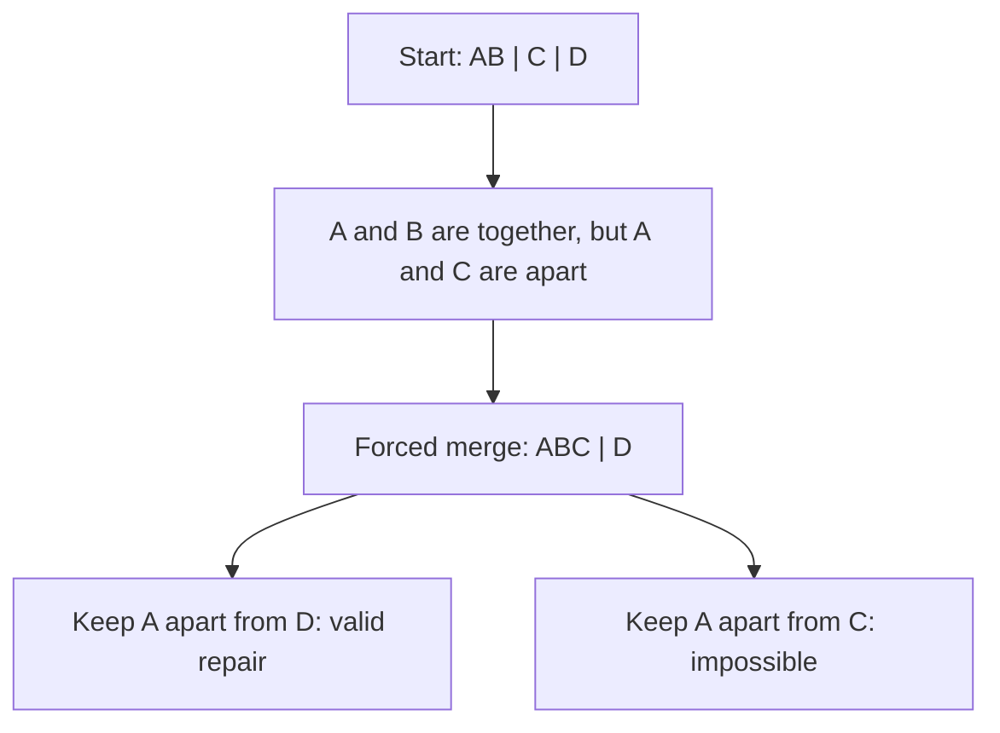

# Can checked counterexamples help an agent repair a grouping?

This experiment connects a real Codex model to the four-object checker. The
agent receives a failed grouping, proposes a permitted repair or says none
exists, and receives checked feedback. We compare plain pass/fail feedback
with feedback that also identifies a violating pair.

The [versioned protocol](../benchmarks/repair-v1/protocol.json) and
[dataset](../benchmarks/repair-v1/tasks.json) are fixed before the held-out run.
Results will be reported here after execution. Creating a dataset does not
establish that either feedback style helps.

## What counts as a repair?

Keep the rule fixed. Merge whole original groups; never split them. Keep a
specified pair of objects apart. The final grouping must respect the rule.
These constraints prevent two automatic answers: putting everything together
loses the required separation, while putting every object alone splits an
original group.

For example, take this rule and starting grouping:

```text
Rule:       A → A     B → C     C → C     D → D
Grouping:   {A, B} | {C} | {D}
```

A and B are together, but their outputs A and C are apart. The checker returns
the concrete pair (A, B). Any permitted repair has to merge A's and C's groups:



The same rule and starting grouping can therefore be solvable or impossible,
depending on which separation must survive. “Impossible” is a legitimate answer
that needs checking, not an invitation to relax the constraints.

In symbols, for initial labels g, proposed labels r, fixed rule f, and the
required separated pair (a,b), a repair must satisfy all three conditions:

1. g(x) = g(y) implies r(x) = r(y): no original group is split.
2. r(a) ≠ r(b): the designated objects stay separate.
3. r(x) = r(y) implies r(f(x)) = r(f(y)): the rule respects the repaired grouping.

Only the third condition and the preservation counterexample are covered by
the existing [Lean checker proof](GROUPING_CHECKER.md). The new constraint
validator and impossibility oracle are tested Python code.

## How the comparison works

The main test set contains twelve cases: six solvable and six impossible.
All start with three groups. Rejected two-group inputs are necessarily
impossible under a retained separation, so including those only in the
impossible class would give away the answer through the group count.

The six test operation families are disjoint from the two development operation
families, even after renaming objects. Within a split, equivalent tasks under
renaming are deduplicated. Four development cases check the harness. The held-out
designation concerns local development only; model training exposure is unknown.
Task selection is deterministic and specified in the dataset.

Each task runs once in each feedback arm with the same requested model,
reasoning setting, answer format, and maximum of three decisions. Trial order
is seeded and shuffled. The **primary metric is the first decision's
correctness after the initial rejection feedback**. Secondary measures include
eventual correctness, model calls, reported tokens, constraint violations,
and false impossibility claims, with solvable/impossible outcomes separated.

The arms differ only in whether a failed preservation check includes
`violating_pair`. Constraint errors have identical messages in both arms. An
impossibility claim ends the trial; the private oracle's answer never becomes
interactive feedback. There is no model-based judge.

A repair can receive credit only after an actual invocation of the identified
native executable, equality with its saved exhaustive result, and validation
of its individual evidence record. The additional constraints are checked
separately. For impossibility, the oracle enumerates all fifteen partitions.
An independently implemented forced-merge closure agrees with that oracle on
all **8,832** eligible tasks: **2,112 solvable** and **6,720 impossible**.

## Why this is a small pilot

Every solvable case in this four-object universe has exactly one permitted
repaired partition, up to renaming group labels. There are only two proper
merges compatible with the required separation from a rejected three-group
starting point. Two candidate probes can exhaust that repair space.

There is an even tighter limitation: three groups on four objects have exactly
one distinct same-group pair. Knowing the grouping fails already identifies
that pair as a counterexample. This pilot measures the benefit of **explicitly
highlighting inferable information**. It does not test the value of revealing
an otherwise unidentified conflict among many possibilities.

Both arms may therefore score perfectly. That would show the end-to-end repair
and scoring interface works on these cases, while leaving feedback benefit
unestablished. A useful next experiment would increase the carrier size and
number of possible conflicts, extending the checker assurance to match. The
current proof must not be silently attributed to a larger implementation.

Twelve paired tasks from six families, one repetition, and one model setting
support descriptive results. The tasks are clustered by operation family, and
equal decision budgets do not imply equal computation or token budgets. No
claim of statistical significance, general AI reasoning gains, or mathematical
novelty follows from this pilot.

## Local Codex connection

The runner uses the installed CLI's existing **ChatGPT sign-in**. It does not
need an OpenAI API key or copy credentials. It consumes the signed-in user's
Codex allowance. OpenAI documents both [Codex authentication](https://learn.chatgpt.com/docs/auth)
and [noninteractive execution with saved authentication](https://learn.chatgpt.com/docs/non-interactive-mode).
Live model calls are a local, explicit command; repository CI runs deterministic
checks and saved-result replay only.

Every decision starts a fresh ephemeral Codex process in a temporary directory
containing only the output schema. The runner sends that trial's public task
and accumulated answers/feedback. It requests disabled shell, multi-agent,
plugin, app, and web tools and rejects any recorded tool activity. Ignoring user
configuration and project documents does **not** remove global AGENTS.md on the
tested CLI. Its hash and byte count are recorded, and the run checks that it
does not change. No global instruction contents or authentication data are
copied into the repository. This is a local harness evaluation with that
inherited context, not proof of completely isolated model access. The model
name and reasoning setting are requested identifiers, not a verified immutable
server model snapshot.

From the repository root, with Python 3.10+, an installed signed-in Codex CLI,
and the matching native checker:

```console
codex login status
python scripts/repair_tasks.py --check
python -m unittest discover -s scripts -p "test_repair*.py" -v
python scripts/run_repair_benchmark.py run --model YOUR_CODEX_MODEL --effort YOUR_EFFORT --split dev --out runs/repair-dev
python scripts/run_repair_benchmark.py run --model YOUR_CODEX_MODEL --effort YOUR_EFFORT --split test --out runs/repair-test
python scripts/run_repair_benchmark.py replay runs/repair-test
```

On Windows with the Linux checker built in WSL, add
`--wsl-distribution YOUR_DISTRO` to each `run` command. `--binary` selects the
local executable path; it must match the hash in the saved checker receipt.
The pilot uses `gpt-6-astra` and `ultra`, matching the maintainer's existing
local configuration. A timeout or transport failure retains the partial logs
and aborts the run. It is an execution failure, not an incorrect mathematical
answer; retries are not silently substituted.

Each completed run retains every supplied prompt, CLI event transcript, answer,
native claim record, process result, and usage report. Offline `replay` checks
hashes, prompt construction, feedback, native evidence bindings, grades,
paired coverage, and aggregate results without calling a model. Hashes provide
reproducibility checks; they do not authenticate a claim of model authorship.
