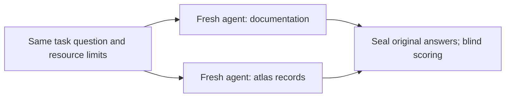
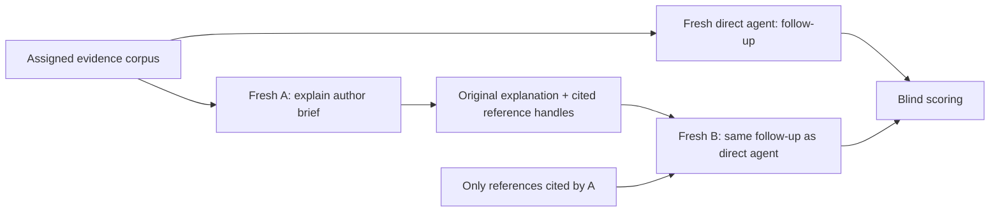

# Does the atlas help preserve a claim's meaning?

**Status: revised pre-run proposal, draft 2. No comparison answers or scores exist.**
The first pilot is a direct-answer feasibility check using two task families,
two conditions, and one attempt per task/condition: **four fresh answering
sessions**. Handoffs and repeated trials are deferred; their larger design is
retained below. Four answers can expose practical problems and guide a larger
experiment, but cannot establish a reliable performance advantage. The remaining
four proposed families are unchanged and reserved. The earlier six-question
[Turing exercise](TM_ATLAS_EVALUATION.md) remains a smoke test, outside every
comparison denominator.

The question is whether structured records help an agent keep the exact object,
property, assumptions, scope, and evidence attached to a claim when answering
and handing work to another agent. A tie or regression is a useful result.
This experiment evaluates use of evidence; it cannot prove semantic preservation.

## Frozen starting point

The atlas is pinned to repository commit
`cddf9cf1c2d06df36bc516fb0b461daf6365920e`. The
[freeze manifest](../benchmarks/semantic-context-v1/freeze.json) records its Git
tree, selected data/source/smoke-test blob identities, exact byte SHA-256 values,
and separate CRLF-to-LF hashes used by existing atlas citations. The full commit
pins the remaining repository files. This is an experiment snapshot, not a
restriction on future project development.

```sh
python scripts/check_semantic_freeze.py
python scripts/check_semantic_freeze.py --worktree
```

The first check reads objects from that commit; the second also checks the listed
local files after CRLF-to-LF normalization. Neither makes model calls or checks mathematical
claims. Existing evidence schema and Lean definitions remain unchanged.

Authoritative references retained in both conditions include the pinned
[upstream machine definitions](https://github.com/openai/math/blob/1581d4cbdd69a0faf34b2089614fe2a814316a6a/lean/ComparatorChallenges/NavierStokesAlternating.lean#L10-L66),
[local step lemmas](https://github.com/Maverick0351a/finite-congruence-checks/blob/8b8401da69a77fde583d96c8dde8f750388c37dd/lean/tm/MachineChecks.lean),
[exact N5 graph bridge](https://github.com/Maverick0351a/finite-congruence-checks/blob/cddf9cf1c2d06df36bc516fb0b461daf6365920e/lean/upstream/ConcreteBridge.lean#L82-L156),
and [grouping checker proofs](https://github.com/Maverick0351a/finite-congruence-checks/blob/cddf9cf1c2d06df36bc516fb0b461daf6365920e/lean/GroupingChecker.lean).
The broker serves frozen local excerpts and retains these provenance URLs;
answering agents do not browse a changing remote branch.

## Proposed tasks

Exact wording is in [tasks.json](../benchmarks/semantic-context-v1/tasks.json).
The initial pilot delivers only the self-contained `follow_up` question to each
direct agent. Author briefs and later receiving-agent questions are retained for
the deferred handoff design. The full task file, this protocol, coverage notes,
and the answer key are excluded from answering environments; an agent receives
only its assigned prompt. These are new question combinations on existing data,
not unseen mathematical constructions or a contamination-free benchmark. BB4
facts overlap the previous smoke exercise. No training-data exclusion is claimed.

| ID | Subject (also retained as a later A brief) | Direct question; same question for a later B | Stage |
| --- | --- | --- | --- |
| SC01 | B2 entries `n4-E16433` and `n4-E16451`: exact families, rules, minima, and scope | A proposed shared minimum for these entries and arbitrary B2 realizations; give the justified replacement | Initial pilot |
| SC02 | M3 entries `n3-E31` and `n4-E18753`: carriers, empty signatures, and minima | Whether a zero-rule entry is missing data, whether its minimum transfers, and what changes if a nonempty signature is required | Reserved |
| SC03 | The saved N5 graph theorem and atlas entry `n4-E16709`: their exact tables and evidence | Whether the theorem directly certifies the atlas entry's construction and minimum; identify any missing bridge | Reserved |
| SC04 | BB3 and BB4 encoding pairs on blank input: time, full tape, head, and evidence | Whether an exporter retaining only tape can substitute one encoding for the other for each pair, and whether the conclusion extends to complete configurations | Reserved |
| SC05 | BB3's step 13→14 and 14→15, both sides: table lookups and applicable lemmas | Which source lemmas apply at each step and whether the reasoning proves equivalence of the Python port for all machines/inputs | Initial pilot |
| SC06 | Coverage of BB3 input `[]` versus `[0,1]`, source lemmas, and available trace receipts | Whether a saved record establishes equal stopping times for `[0,1]`; distinguish absent evidence from a negative result and from the blank-input observation | Reserved |

Supported observations and applicable source theorems earn credit alongside
appropriate refusals. Always answering “insufficient evidence” fails supported
parts. A new manual derivation may be considered on its merits, but cannot be
described as a saved execution record or Lean theorem.

The initial pilot has **2 distinct task families** (SC01 grouping, SC05 Turing
machine), 2 arms, and one attempt per task/arm: **4 direct answers**, followed
by **4 blind reviews**. No A or B sessions and no repeated trials run in this
phase. Each session may make several inference requests as it retrieves
references; four answering sessions does not mean four underlying requests.

The larger design remains available for later review: adding A and B for these
same two families would add eight answering sessions. Running the four reserved
families through all three stages would add 24; a further repetition of all six
families and stages would add 36. These are deferred possibilities, not scheduled
runs. Repetitions and stages do not create new independent task families.
Keep pilot results separate if any prompt, corpus, budget, scorer, or runner
changes before a later phase. Do not alter or run the four reserved families
during this feasibility check.

## Matched information, different presentation

Prepare a common inventory of frozen facts and logical evidence units before
either condition runs. Include all grouping entries and four TM pairs, definitions,
claim qualifications, operation tables, exact input encodings, complete trace
prefixes, relevant receipts, and applicable Lean sources. Include non-target
records so retrieval is necessary. Do not supply task-specific summaries.

* **Documentation:** ordinary readable pages, headings, prose, and tables with
  source references. State every assumption, limit, evidence status, identity,
  and number present in the corresponding records. No extra analogy or hint.
* **Atlas:** existing structured records with those same facts. No added answer
  fields, task labels, computed verdicts, or privileged comparison command.

Use a shared `search(query)` / `read(reference, page)` broker. Search the same
condition-independent inventory text with the same deterministic ranking and
neutral titles. Return the same matching unit IDs in either condition. `read`
renders a unit as documentation or a record. Authoritative Lean source, raw
trace, input, and receipt units are byte-identical in both arms. Both arms can
retrieve the same sources through the same broker. No shell or unrestricted web.
This controls retrieval quality and tests representation plus evidence use;
it does not test an advantage from an atlas-specific search algorithm.

Use the same logical boundaries: one construction, one property claim with its
qualifications, one complete pair-side prefix, or one source declaration with
its required definitions. Pagination may vary with rendering length; do not
truncate one arm's qualifications. Log characters and tokens served. Neither
arm gets longer answers, additional facts, or additional calls to compensate.
Different serialization length is a measured cost of the representation.

Before inference, audit a **two-way fact map**, including negative/absence facts,
all hypotheses, references, and provenance. An independent reviewer reads both
packets and the inventory without task answers and checks for omissions and
unequal hints. Automated equality checks cover IDs, values, tables, and references;
they cannot establish semantic equivalence of the prose. Freeze both packet
hashes, inventory, renderer, prompts, and resource rules after this audit.

## Initial pilot: direct answers only

Start four fresh, un-forked contexts: SC01/documentation, SC01/atlas,
SC05/atlas, SC05/documentation. Each receives the identical shared instructions,
its existing direct question, and its assigned search/read interface. Seal all
four original outputs before blind scoring. Collect no explanations for handoff
and no receiving-agent answers in this phase.



Compare direct answers by task and dimension, inspect retrieval and justification
failures in either arm, and check for ceiling effects. If both arms answer all
requested parts correctly with little effort, report that the task may be too
easy under these scaffolded prompts. Four high scores would neither prove equal
performance nor demonstrate an atlas advantage. Never tune a task using its
pilot answer and then label a rerun held out.

## Deferred design: explanation handoffs

This section preserves the larger experiment and is inactive in the first pilot.



1. Run all initial direct sessions first. Seal outputs before any handoff sessions.
2. Start a new A for each task/condition/repetition. A never sees the direct
   answer, B's follow-up wording, other answers, scores, or the key. Its brief
   explicitly requests the semantic units later needed in the follow-up.
3. Start a new B. Give B the follow-up, A's **unaltered** explanation and citation
   list, and the common answer instructions. No A reasoning trace, tool history,
   conversation memory, original brief, or full corpus search is available.
4. B can reopen only logical reference units actually cited by A, in that arm's
   rendering. It cannot follow outgoing links to new units. No root-directory,
   whole-corpus citation, or wildcard expands this allowlist. An unresolved A
   citation stays visible and returns the same explicit error in either arm.
5. If A returns an empty/failed answer, B still gets the fixed follow-up and
   a neutral “no explanation received” marker; retain and score that failure.

The A length and citation limits apply identically in both arms. Preserve an
over-limit response unchanged, flag the violation, and deliver it unchanged to
B; do not silently trim or improve it. Report such chains as protocol violations
separately from compliant chains, while retaining them in the assigned-run table
and semantic comparison. Output-rule violations are outcomes, not exclusions.

Score B against the full key, and compare A→B only on predeclared overlapping
semantic units. Report retained-correct, lost, recovered, inherited-wrong, and
newly-wrong units. If B corrects A after opening evidence, label it
**citation-assisted recovery** when supported by the access log. A correct B
answer does not alone show that A's prose preserved the meaning. This pilot
does not causally isolate prose-only retention; that needs another condition.

## Isolation and model controls

Use fresh, un-forked contexts for every D/A/B session. The author and protocol
reviewer are never answering agents. The answer key and graders live in a
separate controller/reviewer environment, outside the answering process's
filesystem, tool namespace, network, and memory access. An ignored folder or an
instruction not to read a file is not isolation.

The proposed runner uses a dedicated Codex app-server session and the broker.
Only the two broker operations (search and read) may be callable; capture the
model's final text directly. Remove
or deny built-in filesystem, shell, browser, connectors, delegation, and memory
tools and inherited project instructions. If that cannot be enforced, use a
separate restricted executor before collecting benchmark answers. Do not use
the shared collaboration workspace as a fallback answering environment.

Preflight must attempt forbidden reads (key, scorer, other arm, prior outputs,
host files, guessed references, path traversal, outside URLs) and verify fresh
contexts. B's narrower allowlist is an additional gate for any later handoff
phase. A successful forbidden read blocks inference. If isolation or actual
usage reporting cannot be enforced, report the limitation and pause execution;
do not collect the four task answers through a weaker fallback. Enforce an
allowlist, not a list of forbidden filenames. Grading runs
only after original outputs have been sealed; never send its feedback to D/A/B.

Choose one available Codex model before execution, explicitly set the same
model identifier and reasoning effort (proposed: medium), and record all
supported generation settings. Leave unsupported temperature/seed controls
unset and record that fact. Record client version, configuration digest,
resolved model identity when exposed, and every rerouting event. No automatic
fallback model. A changed/rerouted model invalidates the matched comparison;
retain that attempt and restart the whole pair under a new trial ID if allowed.
If an immutable backend snapshot is unavailable, disclose that limit.

Counterbalance order within each stage: SC01 documentation first, SC05 atlas
first; reverse for any later repetition. Keep adjacent matched sessions close
in time. Neither arm reuses the other's thread. Avoid parallel inference in
the first pilot to make time/resource accounting interpretable. Log cache use;
do not claim identical cache state or wall-time causality.

## Budgets, telemetry, and estimated usage

The direct column governs this pilot; the other roles remain deferred.

| Limit per fresh answering session | Direct (also future A) | Future B |
| --- | ---: | ---: |
| Broker calls, including failed calls | 8 | 8 |
| Total returned reference text (UTF-8 bytes) | 48,000 | 48,000 |
| Search results per call | 5 | Search unavailable |
| Wall time, including tool waits | 300 seconds | 300 seconds |
| Soft interrupt threshold: total reported input + output tokens | 40,000 | 40,000 |
| Final prose | 400 words | 400 words |
| Cited logical reference units | 8 | 8 |

Broker and wall-time limits are enforced by the controller. Token updates are
asynchronous: the token threshold is a soft stop, and any overshoot must be
reported. Record cumulative usage at every update and interrupt at the first
update crossing the threshold. For each logical read, return at most 12,000
UTF-8 bytes with a continuation page; search returns neutral titles/IDs and at
most 4,000 bytes total. Both count against the session byte budget. No submit
tool is required: final text can be returned after all read calls are spent.
Direct and B have equal ceilings; their access to uncited material differs by
design. Run no comparison if the runner cannot enforce the broker limits,
interrupt on time, or obtain actual token usage. Do not substitute character
estimates for actual usage or treat unavailable counters as zero. Word/citation
limits are compliance checks, not silent response edits.

Before freezing the rendered packets, verify deterministically that the support
for every required subclaim fits within the shared call, byte, citation, and
prose limits in both arms, including SC05's several source/trace units and
SC04's complete prefixes when that reserved task is eventually scheduled. A/B
citation feasibility is a later handoff gate. If limits need adjustment, change both arms
together before inference and retain the preparation revision. This is a
feasibility check, not an answering-model trial.

For **4 direct-answer sessions**, a planning estimate is 10,000–30,000 cumulative
input tokens and 1,000–4,000 output tokens per session: **44,000–136,000 tokens**.
One blind review per original response adds **4 reviewer sessions**, estimated
at 5,000–12,000 input and 500–1,500 output tokens each: **22,000–54,000 tokens**.
Combined estimate: **66,000–190,000 tokens**, including reasoning where the
provider counts it in output, with roughly **10–35 minutes** of run/review time.
These are budgeting assumptions, not measured costs, hard caps, or a dollar quote.
Preparation, preflight, and additional ambiguity adjudication are separate.
Show this revised estimate to the user before execution. Neither reserved tasks,
handoffs, nor repeated trials are included in this estimate or scheduled phase.

Use the existing Codex account only after the runner preflight succeeds; no paid
API integration or calls are authorized by this proposal. A Codex-based run
consumes account allowance. If that route cannot supply the required controls,
return the limitation before changing providers or incurring API charges.

Record per session: task ID, repetition, stage, arm (controller only), model and
settings, prompt/corpus/key/scorer digests, start/end UTC and monotonic duration,
raw provider events, input/cached-input/output/reasoning-output/total tokens,
broker attempts and responses including failures, bytes served, timeout,
truncation, refusal, interruption, parse error, fallback, and exit status.
Cached input and reasoning output may be subsets; preserve raw counters and
their documented definitions instead of adding overlapping fields. Also retain
cache-write counters when supplied. Save the
final cumulative usage once per fresh session rather than summing cumulative
updates. Record missing telemetry as null and mark the attempt unusable for the
resource comparison. Preserve model text byte-for-byte before extraction.

Current feasibility: installed CLI `0.163.0-alpha.10.2` can generate protocol
schemas with input, cached-input, output, reasoning-output, and total-token
fields. Official [app-server documentation](https://learn.chatgpt.com/docs/app-server)
describes usage notifications, rerouting events, and client-handled dynamic
tools. These support the proposed design. Tool isolation, authenticated
inference, budget interruption, and complete telemetry have **not** been
demonstrated by this preparation. Reinspection of the local schemas confirms an
`environments: []` option and usage event fields; a schema is not an enforcement
test or a captured usage event. Execution remains paused at these unverified
gates. No auth material was read or copied.

## Scoring and blind review

The [rubric](../benchmarks/semantic-context-v1/rubric.json) scores eight dimensions
separately, 0/1/2 each. A 16/16 total requires complete, correctly justified
answers across all dimensions; also publish the dimension vector, not only a sum.

| Dimension | Full credit requires |
| --- | --- |
| Exact objects and inputs | Correct construction/pair, side, carrier or input, and step where relevant |
| Property | Distinguish the requested minimum, preservation, first halt, tape, head, or theorem |
| Assumptions | Identify necessary operation class, empty-signature convention, source hypotheses, and input conditions |
| Scope and quantifiers | Keep fixed-construction, bounded-execution, and genuinely quantified theorem claims distinct |
| Conclusion | Correct values/verdicts for every requested subclaim, without extra false claims |
| Evidence status | Correctly label execution, independent computation, source proof, and missing proof |
| Citation correctness | References resolve to the exact version/object and support the attached claim, including applicable lemma hypotheses |
| Evidence sufficiency | Support justified claims; abstain on unsupported ones without turning absence into falsity |

**2** = complete and correct for required units; **1** = correct but incomplete,
with no material false assertion in that dimension; **0** = absent, materially
wrong, or contradicted. If a conclusion is right for a wrong reason, score the
conclusion separately and score the defective justification dimensions down;
it cannot receive full credit. A correct URL/hash alone earns no entailment
credit. Negative evidence claims must specify the bounded collection searched.

Before runs, finalize a private key of required semantic units, allowed verdicts,
exact reference bindings and acceptable alternative derivations. A/B overlap
units are required only before a later handoff phase. Commit the key hash with
the run registration; keep the contents out of both
answering environments. The general rubric is shared equally; task-specific
units and verdicts are withheld. Freeze grader version and extraction rules.

Deterministic checks validate IDs, inputs, numbers, full tape cells, step ranges,
reference existence/version, and declared evidence categories where explicitly
present. A separate extractor records exact text spans; it never fills missing
content or rewrites an answer. Ambiguous extraction is reviewed as ambiguous,
not guessed. String matching cannot decide scope, entailment, or lemma use.

A reviewer receives the task, key, unedited answer, and canonical source units,
with randomized response IDs and arm/model/order/cost metadata removed.
Map presentation-specific citation handles to common source IDs in a separate
view, retaining original strings and the mapping. Do not rewrite prose to hide
its style. Review one response per fresh context in randomized order. Score
explanation validity and whether every cited lemma's hypotheses match its use.
Reviewer sessions have identical limits: eight source reads, 64,000 retrieved
UTF-8 bytes, 180 seconds, and a 30,000-token soft interrupt threshold. Record
review failures and ambiguity without silently awarding or dropping scores.
The reviewer guesses the arm only after locking its scores, with confidence; report this
masking check since prose can reveal format. Same-model AI review is not
independent human review. Preserve reviewer disagreements and adjudication
reasons; never fix an answer to improve its score. A second reviewer is used
only for flagged ambiguous cases, with its additional usage recorded.

## Reporting and decisions

Publish every assigned run, including empty answers and tool/provider failures.
No silent retries, answer repairs, or exclusions of inconvenient scores. For a
technical retry, retain the original and report the replacement separately.
Report semantic scores and protocol/technical validity separately. Refusals,
empty answers, output-rule violations, and exhaustion of correctly enforced
limits remain comparison outcomes. Reserve **no comparison** for leakage,
wrong/rerouted models, or compromised/harness/provider execution failures;
retain and report those attempts, rather than treating them as ties or wins.

For each task, stage, repetition, and dimension show documentation score, atlas
score, and delta: improvement, tie, or regression. Ties distinguish both-correct,
both-partial, and both-wrong. For this pilot include direct answers,
wrong-justification cases, justified/incorrect abstentions, tool use, tokens,
latency, and failures. No combined “win rate” hiding dimension regressions.
Use task-level paired summaries; do not count direct/A/B or repetitions as
independent task samples. With two pilot families, describe cases and uncertainty
without a significance or general-intelligence claim. Even six families would
remain exploratory and drawn from a very small atlas.

Direct-vs-B results and A→B unit transitions belong only to the deferred handoff
phase. The first report focuses on whether the interface and isolation work,
where either presentation fails, and whether these two tasks are too easy.

Proceed beyond the pilot only after reviewing parity, isolation, grader errors,
resource limits, and the complete result table. Progress never depends on an
atlas advantage. If pilot observations cause revisions, version the protocol
and keep those pilot tasks as development examples; use the reserved families
for the revised evaluation and disclose overlap in underlying records.

## Preparation record

2026-10-18: inspected frozen atlas and proof identities, old smoke protocol,
local runner version and generated usage schemas; prepared tasks, rubric and
freeze checker. A separate methodology reviewer assessed the design; revisions
aligned the direct/B question, distinguished citation-assisted recovery, equalized
direct/B resource ceilings, required capability isolation and packet-budget
preflight, and retained refusals and budget exhaustion as comparison outcomes.
This was design review, without running or grading answering agents. No evidence
schema changes, API calls, new mathematical
proofs, or comparison results are part of this milestone. Matched rendered
corpora, private answer key, enforcement runner, and blind result scoring are
execution work after review of this proposal.

Draft 2: narrowed the initial pilot to SC01 and SC05 direct answers under both
conditions (four answering and four blind review sessions). Retained the larger
handoff design, unchanged task wording and reserved families, matched-information
requirements, rubric, and evidence schema. Revised the usage estimate and kept
isolation/live telemetry as mandatory gates. No comparison answers were run.

The [preparation record](../benchmarks/semantic-context-v1/preparation.json)
lists completed checks, artifact hashes, and the gates still pending.
