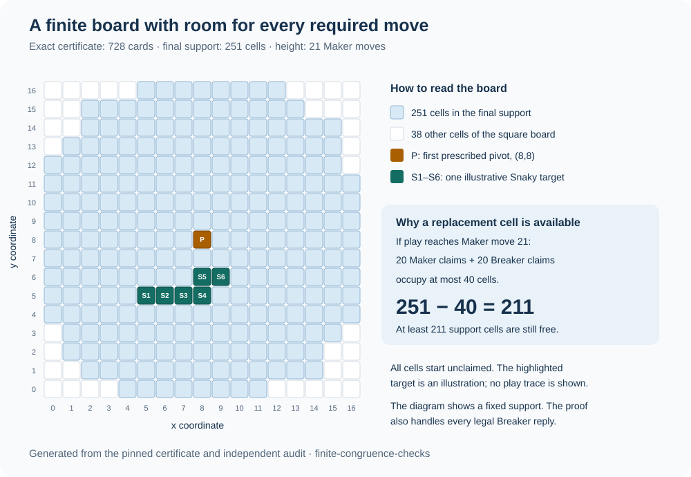

# Snaky on a finite board

Development record: the certificate reconstruction has passed. The finite-board
Lean extension and its proof receipt are being prepared; this page does not yet
report a completed formal verification.

Two players take turns claiming an empty square. Maker moves first and tries to
own a copy of this six-cell shape. Breaker tries to prevent that. Rotations,
reflections and translations of the shape count; resizing does not.

```text
               ■ ■
         ■ ■ ■ ■
         0 1 2 3 4   x
```

The bottom row is `y = 0`; the upper cells are `(3,1)` and `(4,1)`. The formal
definition is the pinned upstream [`snaky` and `HasSnaky`](https://github.com/openai/math/blob/1581d4cbdd69a0faf34b2089614fe2a814316a6a/lean/OAI/GameTheory/SnakyTwentyOne/Model.lean).

The paper already gives a strategy that wins within 21 Maker claims on a
particular set of 251 squares, and therefore on the containing 17 by 17 square.
Its [finite-board argument](https://github.com/openai/math/blob/1581d4cbdd69a0faf34b2089614fe2a814316a6a/preprints/Snaky-in-21-Maker-moves-September-25-2026/build/strategy.tex)
is the result this extension aims to formalize. The upstream Lean
[scope note](https://github.com/openai/math/blob/1581d4cbdd69a0faf34b2089614fe2a814316a6a/lean/docs/187.md)
currently selects the infinite-grid strategy. This project is adding formal
coverage of that finite-board corollary, without asserting a new move bound or
mathematical novelty.

## How the certificate works

Think of a card as a small instruction with three parts:

- **Required cells:** cells Maker already owns.
- **Envelope:** cells Breaker has not yet claimed, where the plan can continue.
- **Height:** how many additional Maker claims suffice.

A card offers several smaller continuation cards. Maker claims its pivot. A
single Breaker reply cannot spoil all the continuations, so Maker chooses one
that survives. Heights decrease along this choice. A base card ends by claiming
the remaining cell of a Snaky copy.

Why must a continuation survive? Any cell shared by **every** child envelope is
already owned by Maker after the pivot claim. Breaker must choose a fresh cell,
so its reply cannot belong to every child envelope. At least one child envelope
therefore stays free of Breaker cells. That is the local condition checked at
each combination, including combinations nested inside a numbered card.

There are 728 cards, including six base cards. The final card is number 727;
it starts with no required Maker cells and has height 21. This is the exact
[certificate](../evidence/snaky-finite-v1/certificate.txt) used here. The older
616-card reconstruction has a different bound and does not support this claim.

## Why the board size matters



Sometimes a card's suggested pivot is already owned by Maker. The proof can use
a fresh replacement cell and continue. An infinite grid always has such a cell.
A finite board needs a count: before Maker's 21st claim, at most 20 Maker cells
and 20 Breaker cells are occupied. That leaves at least `251 − 40 = 211` free
cells on the smaller board.

The formal resource condition carries both occupied cells and remaining moves:

```text
occupied cells + 2 × remaining Maker claims ≤ board size
```

After an ordinary Maker/Breaker round, occupancy rises by two and the remaining
claim budget falls by one. The inequality stays true. A winning Maker move
can end play immediately; it does not require another Breaker reply.

At the empty starting position, this budget asks for at least `2 × 21 = 42`
cells. The theorem also requires the board to contain the entire 251-cell
envelope, so it does not assert that a 42-cell board suffices.

The intended theorem covers every legal Breaker reply on the selected board.
In the square version, Breaker may also play outside the 251-cell envelope.
The finite game definition must require both players' moves to stay on the
board and use fresh cells. It must not treat a position as won merely because
Breaker has no legal reply.

## Evidence and limits

The [independent reconstruction](../evidence/snaky-finite-v1/computational.json)
checks the certificate's finite sets, placements, heights and local combination
conditions. Its Python implementation does not itself prove the game theorem.
The forthcoming Lean proof, typed record binding and receipt will be recorded
separately here when they pass.

Stable claim ID: `context:family-187:snaky:finite-board-21:v1`.

## Reproduce the result

The command being prepared for the completed milestone is:

```sh
python scripts/snaky_proof.py run --out runs/snaky-fresh
```

Use a fresh checkout with Python 3.10 or later, Git, and the pinned Lean 4.34.1
toolchain available through `lake`. The command downloads the pinned Mathlib
dependency cache on its first run. Allow time and disk space for that dependency
and the 728-card proof. The output directory must be new, so a run preserves its
own logs. CI runs the same command on Linux; Windows users can use WSL.
The runner records `LEAN_NUM_THREADS=1` to reduce concurrent compilation work.
This setting is not a strict memory or concurrency limit for `leanchecker`:
the pinned runtime may start another worker when a task waits on dependencies.
The initial replay's observed memory peak is being assessed before hosted CI.

The runner first checks the independent certificate reconstruction and exact
upstream bytes. It then builds the Lean proof, audits the theorem dependencies'
axioms, rechecks the proof modules with `leanchecker`, and compiles seven changed
claim bindings that must fail. Those changes alter the target, envelope, square,
move bound, card number, initial position, or theorem reference. A missing import
or exhausted compiler budget does not count as a successful rejection.

The exact binding checks a mathematical type involving both literal boards, the
literal six-cell target, empty initial sets and move bound 21. It does not rely
only on a filename, theorem name or hash. The original upstream files remain
byte-for-byte copies; sibling modules supply the finite-board argument.

Once the saved proof receipt is available, the existing local query interface
uses it alongside the independent computational record:

```sh
python scripts/query_context.py explain context:family-187:snaky:finite-board-21:v1 --out snaky.json
python scripts/query_context.py check snaky.json
python scripts/snaky_proof.py replay
```

`explain` and `check` replay the saved record and recompute the finite certificate
audit. They do not execute Lean. A changed record is **unsupported by this exact
registration**; that alone does not mean its mathematical conclusion is false.
For example, a smaller board would need its own argument. The three activities
have distinct meanings:

| Check | What it establishes |
| --- | --- |
| Lean build, kernel replay and axiom audit | The formal finite-board strategy statement follows from the displayed definitions under the recorded trust assumptions. |
| Independent Python reconstruction | The certificate's concrete finite calculations pass a separately implemented checker. |
| Record binding and offline replay | This saved atlas claim matches the exact proof statement and recorded artifacts. |

Hashes and saved logs support inspection; they are not authenticated attestations.
The runner pins the dependency manifest and Lean release. It rechecks the local
proof modules and audits their transitive axiom dependencies; it does not attest
every cached Mathlib artifact in the build environment. The hosted CI build
provides a separate reproduction from a fresh repository checkout.

This milestone supplies a formal strategy guarantee. It does not extract or
benchmark a playable policy, prove that 21 is optimal, find a smallest board,
verify a general translator, or measure whether an AI reasons better. The model
benchmark and training remain paused.
