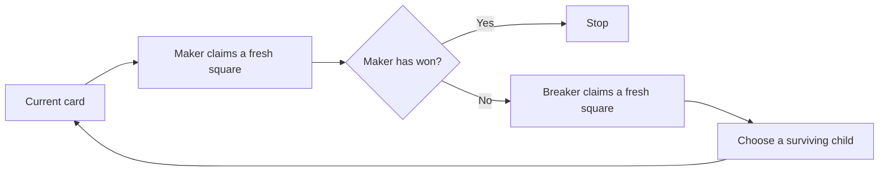

# Follow one Snaky strategy branch

The walkthrough at `space/snaky-play.html` shows one complete play on the
exact 251-cell envelope. Maker owns a six-cell Snaky after eight claims in this
record. The separate [finite-board theorem](SNAKY_FINITE_BOARD.md) guarantees a
win within 21 Maker claims against every legal reply under its formal rules.
One convenient sequence of replies cannot establish a better universal bound.

## What happens at each move

The display advances by a round: a fresh Maker claim and, unless Maker has won,
a fresh Breaker reply. The outlined envelope belongs to the continuation chosen
after that reply. It avoids all Breaker cells. The card's required cells must
already belong to Maker.



For a combination card, any square common to every child envelope already
belongs to Maker after the pivot claim. Breaker cannot claim it legally.
Consequently a legal reply cannot lie inside every child envelope: at least
one continuation survives. A base card completes a copy of the target.

Sometimes the pivot already belongs to Maker. A fresh replacement square
still consumes a Maker claim. The finite-board proof supplies the resource
argument for that case; the example checker also tests replacement accounting.
This recorded branch happens to use no replacement moves.

Three quantities stay distinct in the viewer:

| Quantity | Meaning |
| --- | --- |
| Actual Maker claims | Fresh squares Maker has claimed so far. |
| Remaining 21-claim allowance | 21 minus those actual claims. |
| Card bound | Additional claims sufficient for that particular continuation. |

A child card can have a much lower bound than its parent. That improves the
remaining plan's bound without counting extra moves as played.

## The exact choices

The first two Breaker replies follow the pinned paper's illustrative opening.
Later replies use the lexicographically first free square of the root board.
The adapter selects the first printed child that remains available. These are
reproducible example choices, not an optimized opponent or an extracted,
formally verified policy.

| Maker claim | Maker square | Breaker reply | Card bound before this claim |
| ---: | --- | --- | ---: |
| 1 | (8, 8) | (7, 8) | 21 |
| 2 | (8, 7) | (8, 6) | 20 |
| 3 | (11, 8) | (0, 4) | 18 |
| 4 | (8, 9) | (0, 5) | 14 |
| 5 | (8, 10) | (0, 6) | 7 |
| 6 | (8, 11) | (0, 7) | 3 |
| 7 | (9, 11) | (0, 8) | 2 |
| 8 | (9, 10) | No reply: Maker has won | 1 |

The winning cells are `(8,7), (8,8), (8,9), (8,10), (9,10), (9,11)`.
The complete [record](../evidence/snaky-play-v1/example.json) includes all
ownership sets, coordinate placements, child references and source links.
The two other Maker cells are not part of this winning copy.

## What the adapter adds

[build_snaky_play.py](../scripts/build_snaky_play.py) follows the certificate
and exports this example. [check_snaky_play.py](../scripts/check_snaky_play.py)
independently reconstructs its transformations, moves, ownership and final
target. It does not import the example generator.

[build_snaky_presentation.py](../scripts/build_snaky_presentation.py) requires
that independent replay, the actual saved Lean verification receipt, and a
supported exact atlas claim. It checks that the example's board matches the
proved envelope. It also verifies every linked source against an immutable Git
commit before writing the browser script and JSON download from one packet.

The example replay supports this execution. The Lean proof supports the formal
strategy guarantee. The binding checks connect the saved claim to that proof.
None of these alone proves that the Python adapter implements a winning policy
for all possible plays.

## Reproduce and inspect

From a full checkout, run:

```sh
python scripts/build_snaky_play.py --check
python scripts/check_snaky_play.py
python scripts/build_snaky_presentation.py --check
python -m unittest discover -s scripts -p 'test_snaky*.py' -v
node scripts/check_snaky_play_ui.cjs
```

These commands inspect saved evidence and recompute finite calculations. The
separate fresh proof command is documented in [the formal walkthrough](SNAKY_FINITE_BOARD.md).
The presentation command deliberately fails if its real receipt, source anchor
or generated files are missing. The renderer's explicit `--example-only`
development mode omits the publication packet and cannot certify publication.

The renderer checks are tests against a DOM stub. Real browser layout, native
keyboard controls and mobile readability require a separate visual review.
The complete move table and downloadable record provide alternatives to the
small coordinate labels in the board diagram.
